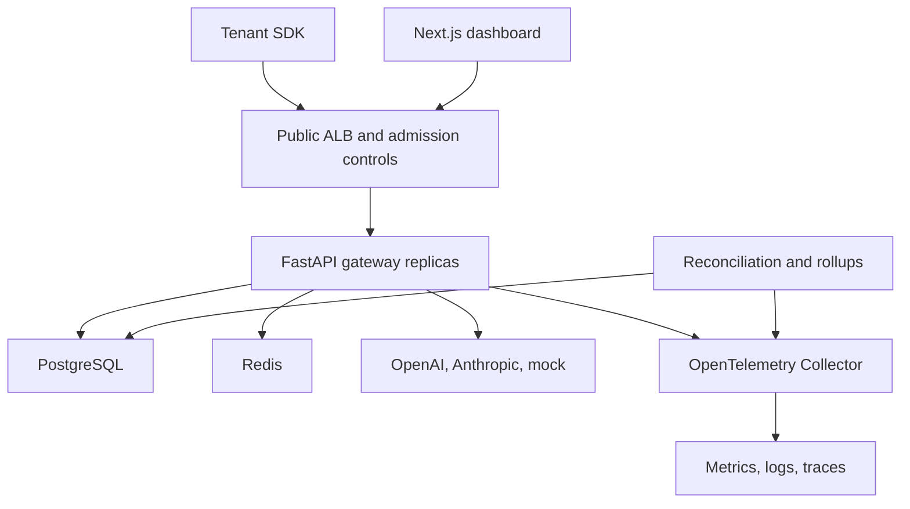
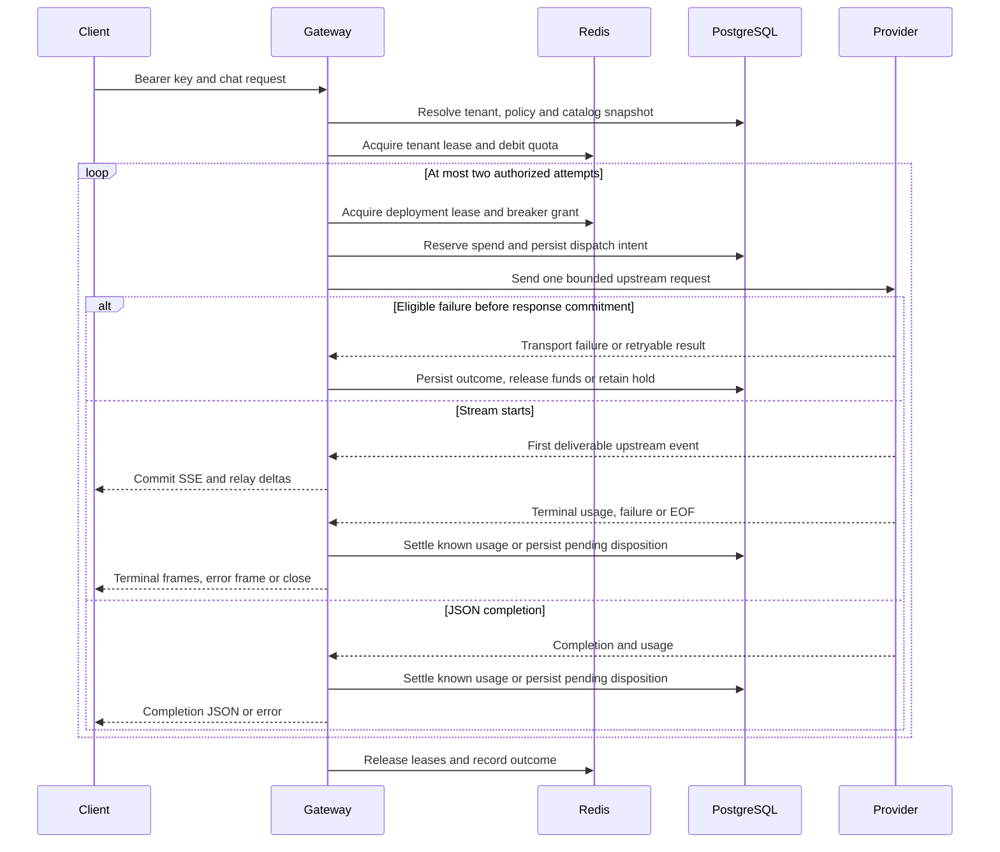
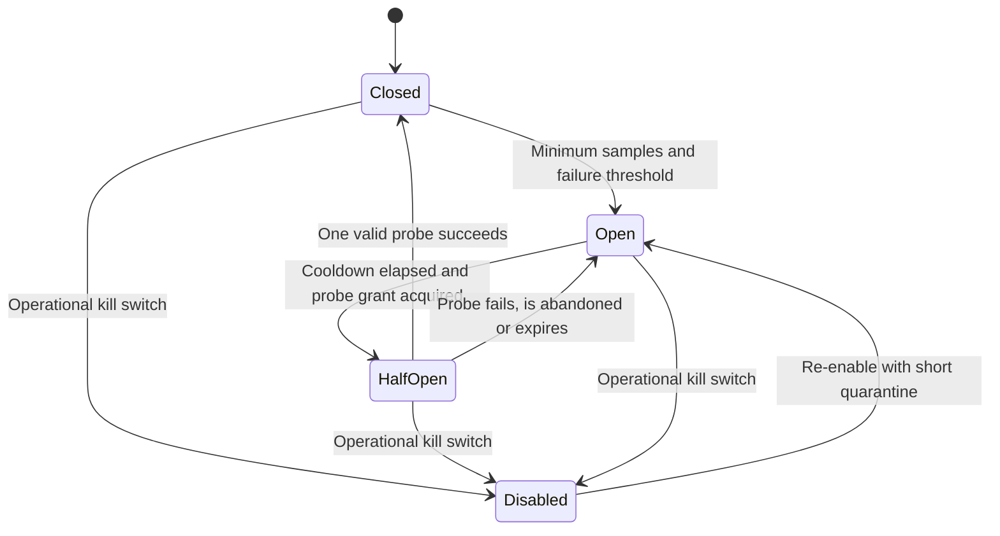
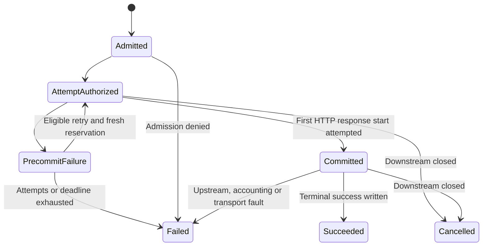
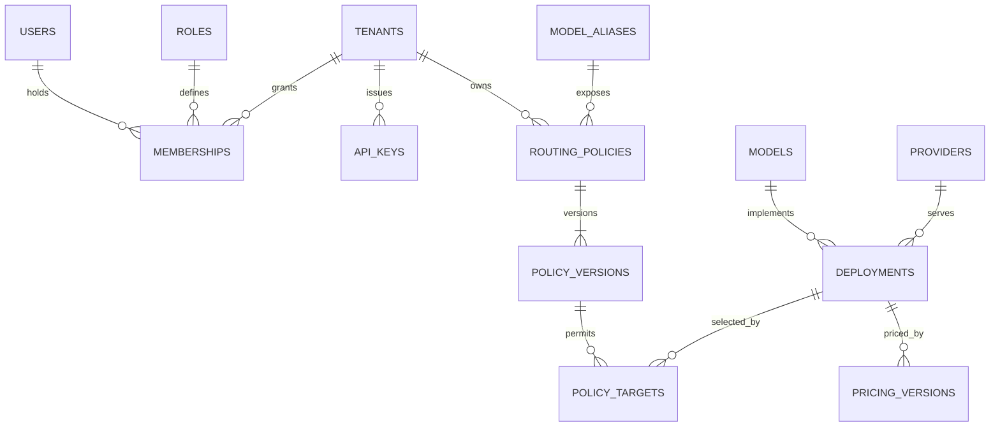
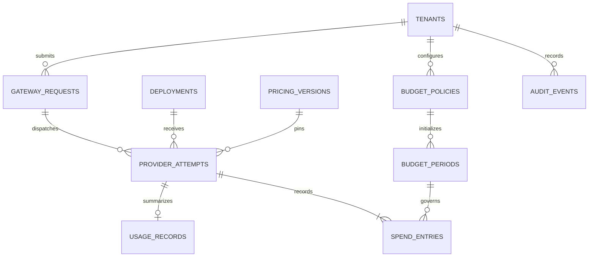
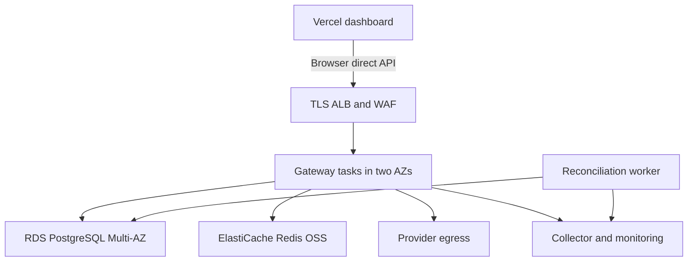

# Aegis AI Gateway — technical blueprint

**Repository** `aegis-ai-gateway` · **Status** proposed design · **Stage** blueprint only · **Date** November 15, 2026

Every feature, SLO, acceptance threshold, and deployment in this document is proposed. The six-day milestone produces a demonstrable vertical slice and time-boxed reliability work. Production release depends on the stated gates.

**Contents**

1. [Executive technical summary](#1-executive-technical-summary)
2. [Product requirements](#2-product-requirements)
3. [Functional requirements and delivery tiers](#3-functional-requirements-and-delivery-tiers)
4. [Nonfunctional requirements and SLO targets](#4-nonfunctional-requirements-and-slo-targets)
5. [High-level architecture](#5-high-level-architecture)
6. [Detailed component architecture](#6-detailed-component-architecture)
7. [Request lifecycle](#7-request-lifecycle)
8. [Routing algorithm specification](#8-routing-algorithm-specification)
9. [Distributed reliability and state machines](#9-distributed-reliability-and-state-machines)
10. [PostgreSQL schema and cost accounting](#10-postgresql-schema-and-cost-accounting)
11. [API contracts](#11-api-contracts)
12. [Security architecture and threat model](#12-security-architecture-and-threat-model)
13. [Dashboard design specification](#13-dashboard-design-specification)
14. [Repository structure](#14-repository-structure)
15. [Deployment and observability architecture](#15-deployment-and-observability-architecture)
16. [CI/CD and release operations](#16-cicd-and-release-operations)
17. [Testing, experiments and benchmark strategy](#17-testing-experiments-and-benchmark-strategy)
18. [Architecture decision records](#18-architecture-decision-records)
19. [Engineering risks and mitigations](#19-engineering-risks-and-mitigations)
20. [Six-day implementation roadmap](#20-six-day-implementation-roadmap)
21. [Measurable acceptance checklist](#21-measurable-acceptance-checklist)
22. [Explicit scope boundaries and trade-offs](#22-explicit-scope-boundaries-and-trade-offs)

## 1. Executive technical summary

Aegis exposes a text-generation subset of the OpenAI Chat Completions API to multiple tenants. A versioned catalog maps public model aliases to approved deployments. A deterministic policy engine filters incompatible or prohibited deployments, scores the remaining deployments on estimated cost, latency, reliability, and priority, and applies explicitly authorized weighted distribution. Provider adapters translate requests, stream events, normalized outcomes, and accounting units. OpenAI, Anthropic, and a deterministic mock share that interface.

Run a modular FastAPI monolith as multiple stateless API tasks in one AWS region. Run reconciliation and rollups as a separate process using the same codebase and image. PostgreSQL owns identity, policy, request attempt state, prices, and spend reservations. Redis coordinates high-frequency admission, short-lived leases, circuit breakers, and operational signals. Next.js on Vercel provides the operations dashboard. The browser calls the gateway directly for playground streaming. The gateway sends telemetry via the OpenTelemetry Collector, with separate operator access to metrics.

Three decisions define the critical path. First, reserve budget durably before each provider dispatch and account for each attempt, including ambiguous upstream failures. Second, commit a streaming response once and stop at that boundary on failure. Third, enforce synchronous tenant and spend checks in PostgreSQL, accepting short database transactions and per-budget serialization in exchange for predictable behavior across replicas.

## 2. Product requirements

| Audience | Job | Product behavior |
| --- | --- | --- |
| Application developer | Integrate one inference API | Use an OpenAI client with a custom base URL, a scoped key, and a discovered alias. Receive a stable completion ID and request ID. |
| Tenant owner | Control access and spend | Manage members, keys, approved routes, and hard budgets. Review denials, pending spend, and policy history. |
| Tenant analyst | Explain spend and performance | Query tenant-scoped usage and compare finalized costs, conservative estimates, unresolved holds, and service health. |
| Platform operator | Maintain reliability | Manage deployments, credential references, pricing, and telemetry. Inspect fleet health and perform controlled rollbacks. |
| Security auditor | Review privileged actions | Inspect attributable, redacted changes and correlate incidents using request IDs. |

The launch scope is USD-denominated, text-only inference for trusted organizational tenants. Organizational onboarding is operator-mediated. Tenants may select a latency class on `model: "auto"`; named aliases have fixed public model semantics and a provider set the tenant explicitly approves. Routing complexity comes from documented input features. Quality equivalence among routes requires enrollment evaluation and explicit operator approval.

## 3. Functional requirements and delivery tiers

| ID | Tier | Requirement |
| --- | --- | --- |
| F1 | 1 | Chat JSON and SSE, strict validation, tenant API-key authentication, catalog discovery, request IDs, mock adapter, consistent error envelope. |
| F2 | 1 | Versioned tenant policies, capability and price checks, deterministic scoring, persisted route/price snapshots, durable reservation and mock settlement. |
| F3 | 1 | Single-process admission controls, tenant membership and a local seeded dashboard identity, real dashboard overview, request and usage pages, policy editor, keys, audit view, health, and a streaming playground. |
| F4 | 2 | OpenAI and Anthropic adapters, shared Redis rate and lease controls, health and circuit coordination, bounded failover, reconciliation and fault recovery for external billing. |
| F5 | 2 | Production OIDC and managed secrets, enforced tenant roles, operator tools, provider management, reliability views, tenant-safe rollups, tracing and alerting, staged deployment verification. |
| F6 | 3 | More models and providers, structured output, tool and multimodal routing, dedicated tenant credentials, region-aware policies and multi-region architecture if warranted. |
| F7 | 3 | Provider billing imports where supported, audit export to immutable storage, scoped replay/idempotency if demanded, analytics offload, controlled optimization experiments. A learned router requires labeled data, evaluation, guardrails and independent approval. |

A Tier 1 deployment runs one gateway process and one reconciliation worker against PostgreSQL. Any dependency on process-local controls is shown as local in health and documentation. Tier 2 is the first candidate for horizontally scaled production. Dashboard routes become available as their data sources and permissions land.

## 4. Nonfunctional requirements and SLO targets

Use rolling 30-day windows and publish counts next to percentages. An **eligible request** uses a valid tenant identity, conforms to the contract, targets an authorized catalog route, and stays within configured tenant entitlement. Exclude client disconnect before any gateway or upstream failure, expected tenant denials, and malformed traffic. Include gateway overload, dependency outage, upstream provider errors, and late stream failures in eligible outcomes. An upstream 429 is an availability failure. For the conditional latency SLI, report the error rate next to the percentile so failures cannot make latency look better.

| SLI or limit | Proposed target and measurement |
| --- | --- |
| End-to-end chat availability | 99.9% over 30 days. A successful stream emits a terminal success sequence and the server successfully writes it to the transport. Nonstreaming succeeds upon writing its terminal JSON. The service does not infer client receipt from a socket write. |
| Gateway latency | p95 ≤ 75 ms and p99 ≤ 150 ms at 100 accepted requests/s. Measure handler start through first dispatch authorization commit using a warmed catalog, including auth, routing, Redis, reservation, and queueing. Track rejected and timed-out admissions separately. |
| Standard streaming latency | p95 time to first semantic output ≤ 2.5 s for the reference standard-class cohort, including admission; report model, catalog revision, and fixture shape. Reference cohort is ≤ 1,024 input tokens, ≤ 128 requested output tokens, same-region gateway, with warm replicas. |
| Standard JSON latency | p95 ≤ 8 s for successful reference-cohort requests. Publish separate distributions by class and provider. |
| Data correctness | One disposition per dispatch attempt, zero double settlement or tenant isolation violations in fault and concurrency tests. Terminal ledger write p95 ≤ 100 ms in healthy staging. Start with 100 ms per request-path SQL statement and 50 ms lock wait, clamped to the overall handler deadline. Use bounded statement timeouts and bounded retries for safe internal pre-dispatch DB transactions; never infer permission to send from a failed or ambiguous commit. |
| Usage freshness | At least 99% of terminal attempts appear within 5 minutes in healthy operation. Pending attempts and rollup watermarks are visible. |
| Resilience | Two gateway tasks in different AZs; AZ loss exercise restores acceptance in ≤ 5 minutes. Region-level restore exercise aims for RPO ≤ 5 minutes and RTO ≤ 60 minutes; single-region service remains unavailable during a regional outage until recovery. |
| Starting scale and guardrails | Load-test two replicas at 100 accepted requests/s and 200 simultaneous SSE streams with a networked mock. Validate the rate and concurrency targets separately and together at sustained fixture lifetimes. Initial maximums are 128 KiB request JSON, 64 messages, 64 KiB per message, 16,384 admitted input tokens and 2,048 output tokens, further restricted by model and policy. |

Record all synthetic and real-provider measurements with the environment, version, mix, duration, and sample counts. Use multiwindow availability alerts at 14.4× burn over both 1 h and 5 min, and 6× over both 6 h and 30 min; mark sparse data and use synthetic probes for low traffic. Define alert ownership before production.

## 5. High-level architecture



The public edge handles TLS, request-size limits where available, and coarse abuse protection. The gateway re-enforces size limits while reading the actual body. The data plane owns completion and model endpoints. The control plane owns membership, keys, versioned policies, budgets, catalogs, and read models. The operator plane uses a distinct authorization audience and an internal listener for metrics. Logical module boundaries remain the same in development and production.

## 6. Detailed component architecture

| Module | Responsibility and boundary |
| --- | --- |
| HTTP and identity | Generate a gateway UUIDv4 request ID before authentication. Validate headers and strict Pydantic schemas, establish a principal and permissions, translate exceptions, and own HTTP/SSE writes. API-key scope, membership, tenant status and key revocation derive from PostgreSQL on each admission. |
| Catalog and policy | Read an authoritative active policy pointer and environment catalog revision from PostgreSQL; memoize immutable versions. Compile stable model IDs, eligibility, rates, fallback edges, caps, and side-effect-free routing decisions. Transactional updates validate and audit all targets. |
| Admission and reliability | Consume request and input-quota units, acquire tenant and deployment concurrency leases, obtain breaker grants, maintain absolute deadlines, and bound queueing and attempt count. |
| Provider adapter | Accept normalized text messages, authorized endpoint and credentials, pinned upstream model, and bounded token limits. Provide capability declarations, token estimates with certified upper bounds where possible, async completion, and an async stream of normalized events. Yield role/text/finish/usage, classify timeout and dispatch certainty, and surface upstream correlation IDs only to authorized operational paths. Adapters never choose a tenant or route. |
| Accounting | Reserve against the tenant’s UTC budget period, mark each provider dispatch durably, reconcile provider usage or settle an explicit conservative estimate, and keep an immutable ledger of financial deltas. Persist request and attempt outcomes in the same short transactions as their relevant accounting changes. |
| Worker | Poll batches of expired attempts and rollup change keys using row locks and `SKIP LOCKED`. Operate through explicitly granted routines, with idempotent work and lease-based recovery. Sharing a binary keeps schema and domain rules synchronized. |
| Telemetry | Record async bounded spans, counters, histograms and decision reason codes. Tenant usage and request views read PostgreSQL. Operational provider signals and quota state reside in Redis. |

Initialize one ASGI/Uvicorn process per container and a reusable `httpx.AsyncClient` per provider endpoint family, with connection limits aligned to its bulkhead. Share `AsyncEngine` and pool per process, and create a separate short-lived `AsyncSession` per database transaction. HTTP and database I/O are asynchronous. Bound any CPU-heavy tokenization with a small executor or reject oversize work. Release database sessions before provider I/O and during streams. Disable provider SDK, HTTP, and infrastructure retries on inference POSTs. Pass a single cancellation signal through leases, deadlines, adapter and transport. Use PostgreSQL row locks and constraints for invariants, and bounded in-process work for dashboard reads and metrics.

**Adapter mapping.** Tier 1 mock returns deterministic text and usage using a versioned fixture from a test-only selector or seeded catalog alias. Support delay, split UTF-8 frames, provider errors, missing usage, disconnect and cancel fixtures with no network. A separate HTTP fake exercises transport and load. Use the OpenAI Chat Completions API and request streaming usage internally. For Anthropic Messages, translate the optional first system message into the dedicated field, accept text-only content, coalesce adjacent same-role turns with a documented newline, set the pinned API version and required max tokens, and process named SSE events. Count initial input and cumulative output usage exactly once. Map OpenAI stop/length/content filtering and Anthropic end/stop sequence, max tokens and refusal into the normalized enum. Fixture-test incompatible sampling fields and model-specific unsupported features. Upstream structured output, reasoning-only, tool-only, image and audio models stay disabled unless their enabled configuration can satisfy this text contract. [OpenAI streaming events](https://developers.openai.com/api/reference/resources/chat/subresources/completions/streaming-events) · [Anthropic streaming messages](https://platform.claude.com/docs/en/build-with-claude/streaming)

## 7. Request lifecycle



The loop stops on response commitment, final nonretryable failure, or exhaustion. Acquire the tenant lease before rate debit and release the lease on denial. Once rate debit succeeds, the request consumes quota regardless of the eventual outcome. In Tier 1 local controls replace Redis and only one attempt runs. Start the total deadline at handler admission and use a monotonic local clock. Assign a completion ID once per request and use fresh attempt IDs for each dispatch. There is no inference idempotency key or public replay API in the initial contract. Clients may create a new billable request by retrying a disconnected or timed-out call.

The first deliverable stream event is content or a validated terminal outcome, so buffered provider setup or role events alone do not trigger successful start. Delay the ASGI response start until that event exists and a final admission check passes. Treat the attempted `http.response.start` send as commitment even if transport write success is ambiguous. Emit bounded frames under backpressure, maintain upstream semantic-progress timers separately from downstream keepalives, and close the upstream response on client disconnect. A terminal success finishes only after the outcome or pending accounting disposition is durable. If PostgreSQL becomes unreachable during streaming, finish with a failure where possible and preserve the durable dispatch intent for reconciliation. When JSON generation finishes but the settlement transaction cannot commit, return `503 accounting_unavailable`. Earlier charges can still be reconciled.

## 8. Routing algorithm specification

### 8.1 Inputs, policy precedence and filtering

**Inputs.** Canonical tenant, active policy version, environment catalog revision, route ID and replayable routing seed, estimated prompt token count `P` and upper bound `U` per candidate, requested output ceiling `M`, required capabilities, remaining deadline, current-period budget snapshot, and replica-local immutable health snapshot. All request attempts share the selected config revisions and UTC budget period. Candidate lease/breaker admission always rechecks live state. A platform emergency kill switch is checked authoritatively inside the dispatch authorization transaction and supersedes the pinned catalog.

1. Apply platform safety and limits. Tenant must be active, route visible, endpoint enabled, and credential permitted. Use configuration-pinned upstream model IDs, TLS destinations, and active price versions. Enforce allowed provider/data-region combinations. An absent route policy denies admission; an active policy instance exists for each exposed tenant alias.
2. Evaluate the tenant’s allowlist and policy tier. Named aliases only select deployments approved for that alias. `auto` uses `standard` or `quality` catalog tags according to the computed minimum. A fallback edge may cross providers only if explicitly listed for that alias and remains inside the same capability, quality, region and policy constraints. Platform limits intersect tenant limits. Client latency-class requests may select an allowed class and never expand permissions.
3. Evaluate capabilities and context. Require requested modality, streaming mode, system message support and any sampling options. Enforce `U + M ≤ context_limit` and `M ≤ deployment_output_limit`. Reject unknown or incompatible named aliases using §11. For `auto`, classify as quality if the canonical text exceeds 3,500 rough tokens (rounded-up UTF-8 bytes / 4), at least nine messages exist, or `M ≥ 1,024`. Otherwise classify as standard. This heuristic is vendor-independent, predictable and untrained. A quality request never silently downgrades. The quality tier is a catalog qualification verified with versioned evaluation prompts.
4. Require pricing across all billable units for the deployment. Enforce the tenant’s maximum authorized cost **per request**, including existing attempted exposure. Use the candidate’s conservative upper bound for this check. Treat a budget snapshot as a hint only. PostgreSQL checks the real available period budget and request cap immediately before dispatch. Uncertified bounds in a hard-budget policy make a deployment ineligible.
5. Exclude open or disabled breakers, active cooldowns, and candidates where predicted response latency exceeds the class hard ceiling *if the tenant enforces it*. Treat cold stats as conservative seeded values. A half-open candidate may obtain a single controlled trial under §9. Ordinary traffic skips it if a healthy candidate is available. Treat an expired open timer as probe-eligible; the subsequent atomic grant decides which request, if any, probes. If runtime admission fails on a shortlisted deployment, skip it, bounded to eight shortlisted deployments and a 100 ms aggregate queue/admission wait. A reservation rejection can try the next eligible affordable candidate without consuming a dispatch attempt. This 100 ms bound applies to queue and Redis live admission waits; database work has its own statement and deadline bounds.

### 8.2 Scoring and weighted distribution

Use integer micro-USD and integer milliseconds. Set `M` to 256 if omitted. Estimated output `E=min(M,max(32,ceil(P/4)))`. Calculate `C` from estimated input and output under the pinned rate card, assuming uncached input for the supported launch profiles. The reservation uses `U`, `M`, and worst-case billable rate and rounding for each supported unit category, including any approved premium cache-write classes. To enroll under a hard cap, version evidence that the bound covers provider envelopes, hidden token rules, exclusive cache classes and applicable rounding. Count adapter-translated text and framing. Use a proven conservative upper bound when exact preflight tokenization is unavailable. Costs use the rounding and unit rules in §10.4.

For class `standard`, use a latency target of 2,500 ms streaming or 8,000 ms JSON. For `interactive`, use 1,500 ms streaming or 5,000 ms JSON. For `batch`, use 5,000 ms streaming or 20,000 ms JSON. Classes change ranking and, if enforced, candidate eligibility. Set hard predicted ceiling to twice the target. Hard wall-clock limits in §9 override all classes.

Normalize each term to integers in `[0,10000]` using floor division and clamping:

| Term | Formula and inputs |
| --- | --- |
| Cost | `Cpen = min(10000, floor(10000*C/cost_reference_microusd))`; default reference 20,000 micro-USD, >0. |
| Latency | `Lpen = min(10000, floor(10000*p95_ms/(2*target_ms)))`; use streaming first semantic output or full JSON latency by mode, with deployment seed for insufficient data. |
| Reliability | `Rpen = min(10000, floor(10000*bad_ppm/100000))`; `bad_ppm` includes eligible upstream 5xx, timeouts, provider 429 and protocol faults, with client cancels excluded. |
| Priority | `Ppen = 10000 - 100*priority`; priority is 0–100, larger preferred. |
| Score | `S = 35*Cpen + 30*Lpen + 25*Rpen + 10*Ppen`. Lower wins. Optional policy weights are nonnegative integers summing to 100. |

Use the newest closed 30-second bucket plus 19 preceding buckets (10 minutes), and fixed millisecond bucket edges `[100,250,500,1000,1500,2500,4000,8000,16000,30000,60000,90000]`. Histogram p95 uses the first upper bucket edge reaching `ceil(0.95*n)` (the upper bound of the observed bucket). Cohorts use deployment, mode, latency class, and workload bucket defined by input ≤1,024 vs ≥1,025 and output ≤128 vs ≥129. Use deployment and mode for reliability, with 20 seeded attempts and one seeded failure, `bad_ppm=floor(1000000*(bad+1)/(total+20))`. With fewer than 30 successful latency observations per cohort, use the catalog’s mode-specific baseline. Exclude late arrival beyond bucket retention. Refresh every 5 seconds. If stale for 30 seconds use catalog seeds and mark the decision as degraded; admission and breaker controls still require Redis. Track both p95 samples and the age of signals.

Rank by `(S ascending, priority descending, deployment UUID bytes ascending)`. Weighted distribution is opt-in and applies only to an initial dispatch. Create a band of candidates at `S ≤ best_S + weighted_band` (default 0, max 50,000), with positive optional integer weights capped at 100. If no positive weights exist or weighting is disabled, take the ranking order. Otherwise sort the band by UUID bytes and derive a weighted slot from the first 64 bits of `SHA-256("aegis-route-v1" || tenant_UUID_bytes || request_UUID_bytes || alias_UUID_bytes || policy_revision_uint64_be)` interpreted unsigned big-endian. Slot is `floor(hash64*total_weight/2^64)`; select the first cumulative weight greater than slot. Try the chosen deployment first, then ranking order if local admission fails. The seed and policy/health snapshot are server-controlled. For failover, traverse only untried, explicitly connected targets ordered by rank, skipping any that fail the current live checks. A same-deployment retry is permitted only for a documented pre-dispatch connectivity fault; prefer an eligible fallback. Selection is deterministic for the same snapshots and admission results. Distributed health views can differ across replicas.

**Example.** With `Cpen=1000,Lpen=2000,Rpen=1000,Ppen=0`, total is 120,000. With `Cpen=500,Lpen=3000,Rpen=2000,Ppen=1000`, total is 167,500. The former ranks first despite higher estimated cost. Persist an algorithm version, selected and attempted deployment IDs, costs, sample age, chosen rank or weighted band, fallback reason and policy revisions. Retain a bounded top-three redacted decision detail plus aggregate reject reasons in the request record. Full provider catalog and cost internals are operator-only.

## 9. Distributed reliability and state machines

### 9.1 Timeouts, retry and failover

Initial values are configuration defaults capped by platform policy. Admission and upstream work share one absolute deadline. Reserve a 500 ms terminal DB and response-write margin before that deadline. Apply 2 s connect/TLS, 2 s upstream request write, 100 ms HTTP connection-pool acquisition, 10 s streaming first semantic output, 15 s inter-semantic-event idle, 30 s JSON provider deadline, 35 s JSON wall time, and 90 s streaming wall time. All sublimits clamp to time remaining. Use a phase/absolute timeout around adapter work in addition to HTTPX inactivity timers. Downstream frame writes time out at 5 s, clamped to the wall time. Limit a pending frame to 32 KiB, at most eight frames or 128 KiB (whichever binds), aggregate returned text to 128 KiB, and upstream SSE event size to 256 KiB. Prefer pull-based streaming with a bounded parser and no independent producer queue. The ASGI writer serializes frames and heartbeat comments every 10 s after commitment if no write is pending. A comment does not reset provider timers. Saturation returns `503 gateway_overloaded` before external dispatch.

Tier 1 has one attempt. Tier 2 caps total dispatch intents at two per request, any same-deployment retry at one, and any half-open probe at one provider attempt with no fallback. Sleep full jitter in `[0,min(1000 ms,100 ms*2^(attempt_number-1))]`, then honor the larger of that delay and a valid upstream `Retry-After` where relevant to the next destination. A different credential quota group is unaffected by a deployment-scoped cooldown. If the chosen destination's delay plus the terminal margin and its minimum 1 s viable attempt window exceed remaining time, skip it. Use capped upstream cooldowns of 1–60 s for shared signals. Delay at most once for the sole second attempt. No hedging.

| Outcome | Breaker and cooldown | Retry or failover | Accounting |
| --- | --- | --- | --- |
| Proven unsent, e.g. connect failure before request bytes | Count upstream network fault except local pool starvation | Yes before commitment; prefer a different deployment and allow documented same-deployment retry when no viable fallback | Release reservation atomically with proven-unsent disposition. |
| Provider 429 | Set credential quota group cooldown; count as provider failure and breaker failure | Yes to another approved credential quota group before commitment if rejection is explicitly known nonbillable, or with ambiguous failover enabled | Release only with documented proof; otherwise keep hold. |
| Provider 5xx, timeout after possible send, upstream EOF/protocol fault | Count provider failure | Only before commitment with tenant `allow_ambiguous_failover=true`, to a different deployment | Preserve hold or settle observed usage; reserve separately for fallback. |
| Provider auth/config error | Count operational error, quarantine that deployment/credential revision for 60 s and page after repeated failure | Only to an eligible different credential, before commitment; apply normal ambiguity rule | Use adapter dispatch classification. |
| Upstream rejects validated content or features | Content rejection is not a breaker fault; a gateway translation defect is an operational protocol fault | Terminal unless outage is classified independently. Map documented policy refusal to successful `content_filter` when the adapter delivers a valid refusal outcome | Settle measured usage; release only if confirmed nonbillable. |
| Client disconnect, local capacity reject, local shutdown | Exclude from breaker samples unless a provider fault was already observed; release probe ownership | Cancel downstream work and close upstream; no retry | After possible send, hold or settle with known usage. |

Retry safety uses observed dispatch certainty plus provider contract evidence. A timeout carries no dispatch certainty by itself. In-flight streams can continue if Redis is briefly unreachable and their existing leases remain valid. If lease renewal cannot complete before the expiry safety margin, cancel the affected attempt, persist the disposition, and apply the response commitment rule. A Redis outage blocks new external admissions. PostgreSQL outage blocks new inference dispatch and privileged writes. Open upstream breakers make that deployment unavailable; healthy permitted alternatives can still serve. OTel and analytics failures shed telemetry or serve stale values with timestamps; neither grants bypass to admission. Upstream lease cancellation and lost client connections can leave provider work running, so upstream concurrency targets are protective estimates.

**Admission examples.** If a connect failure occurs before any write, a second authorized fallback can proceed after the first reservation is released. After an ambiguous timeout, the same fallback needs both the tenant opt-in and enough budget for two exposures. If the timeout occurs after response commitment, the upstream request count stays at one and the client sees a partial stream or transport loss. For a known 429 on a shared credential, an alternate model using the same credential group remains blocked until cooldown.

### 9.2 Breaker and request states



Tier 2 breaker key is deployment ID plus credential revision. Count outcomes in 30 one-second buckets over the trailing 30 seconds using Redis time, with at least 10 eligible results and failure rate ≥ 50% to open. A closed generation opens for 10 s initially. A failed half-open doubles the previous duration up to 60 s; a successful probe resets it. An abandoned probe reopens for the current duration without attributing a provider failure. After the timer, one atomic script transitions to half-open while granting a fenced probe token. Probe TTL is the attempt deadline plus 5 s, capped at 95 s. The same script handles expiry if the owner dies. Only that UUID and generation can close or reopen the breaker with a result. Ignore stale outcomes for breaker transitions after a generation change; count them for operational metrics under their original attempt. Provider cooldown groups handle 429 across deployments using the same provider credential quota group. An absent breaker after failover is uninitialized and enters a 10 s open quarantine before a controlled trial. Restore warm condition via deployment-aware monitoring and bounded test traffic. Admin disable is durable in PostgreSQL; Redis carries advisory status.



The diagram describes client-visible delivery. The database tracks durable generation outcome and best-effort delivery state separately. A task killed between a transport write and its delivery marker leaves delivery `unknown`; it can still have settled usage. JSON errors commit HTTP once after attempt selection ends. After SSE commitment, a semantic failure emits a named `error` event and closes when writing remains possible. Socket loss may be visible only as EOF. No failover, replay, replacement completion, partial-content stitching, or successful terminator after an error. Client SDK guidance and parser tests require either a valid terminal sequence or an incomplete result.

### 9.3 Redis structures and consistency

Use Redis OSS with TLS and primary-only calls in one shard initially, `noeviction`, and reserved memory headroom. Prefix environment and schema version. Use bounded scripts, `TIME`, integer arithmetic within safe precision bounds, and monotonic clamping against backward time movement since the previous update. Use Redis hash tags for multi-key tenant updates and enforce single-slot scripts if sharding is later adopted. There is no cross-slot or cross-datastore transaction.

| State | Key shape, structure and expiration | Atomic behavior |
| --- | --- | --- |
| Tenant and key rates | `ag:v1:{t:<id>}:rate:<scope>` hashes containing request and prompt-unit bucket state, credit and timestamp. Default tenant 120 RPM burst 30, key 60 RPM burst 15, tenant 120k prompt units/min burst 32k, key 60k/min burst 20k. TTL twice full refill time plus 60 s; max configured refill horizon 1 h. | One script checks and debits all tenant/key buckets or none. Cost is one request and deterministic canonical prompt units `ceil(text_utf8_bytes/4)+8*message_count`; quota is intentionally separate from provider-billed tokens. Return `Retry-After` as ceiling of the longest deficit wait. An individual request larger than a bucket burst receives 429 without a retry hint. Debit once per admitted chat, including failed attempts. Internal retries use a provider retry budget, not a second tenant debit. |
| Concurrency | `ag:v1:{t:<id>}:flight`, `ag:v1:{d:<id>}:flight`; sorted sets of opaque lease UUIDs scored by expiry, with key TTL 120 s. Tenant default 16, deployment default 64, initial 30 s lease, renew every 10 s and abort before expiry with a 2 s margin. | Prune expired members, test limit, insert or refuse. Renewal requires owner token present and unexpired. Acquire tenant then deployment, release on every termination and after each attempt for deployment leases. Cap per-task streams at 128 via a local semaphore and provider pool limits; no indefinite queue. The distributed lease protects gateway capacity and cannot fence an external API. |
| Breaker | `ag:v1:{d:<id>}:breaker:<cred_revision>`, hash with bounded ring, generation, cooldown and probe owner; TTL 24 h on active state. | One atomic evaluation or grant/result transition per script. Store per-credential-group 429 cooldown as a separate expiring key using max(existing expiry,new expiry); skip grants when blocked. |
| Retry budget | `ag:v1:{q:<group>}:retry`; bucket, configurable at 5% of planned group primary dispatch rate and burst 5; TTL as rate bucket. | Consume once per second attempt for the selected quota group before dispatch authorization. |
| Routing observations | `ag:v1:{d:<id>}:obs:<mode>:<class>:<workload>:<bucket>`; bounded hash counters and histogram, TTL 15 min. | Increment once per attempt on a best-effort path. Routing health is approximate; telemetry failure does not delay settlement. |
| Immutable versions | Process-local LRU for catalog and policy versions. Optional Redis cache for immutable compiled snapshots with 5 min TTL; key contains tenant, version and catalog revision. | Always get active pointers from PostgreSQL. Cache immutable versions only. Revocation, hard spend, and emergency disable never rely on this cache. |

Use a bounded Redis call budget. If a mutating command’s result is ambiguous, fail the admission and let the debit or lease age out rather than issue a second mutation. Observe Redis failover as an interval where counters, state, or leases can be lost; primary scripts are atomic in a healthy epoch. There is no globally exact rate guarantee across promotion or network partition. Start missing buckets conservatively with at most 25% burst credit, clamp lease renewal to verified state, and alert on primary changes and missing state. Spending remains governed by PostgreSQL reservations. Monitor bucket errors, ambiguous outcomes, fail-closed duration and Redis memory; edge rate rules limit abusive traffic independently. [Redis scripting](https://redis.io/docs/latest/develop/programmability/eval-intro/) · [Redis replication](https://redis.io/docs/latest/operate/oss_and_stack/management/replication/)

## 10. PostgreSQL schema and cost accounting

### 10.1 Relationships





### 10.2 Physical plan

Use time-zone-aware UTC timestamps and application-generated UUIDs. Tenant tables use composite keys and foreign keys prefixed by `tenant_id` wherever a tenant-owned row points to another. Use nonnegative checked integers for money and counts, `BIGINT` for persisted micro-USD and arbitrary-precision intermediate calculations. Apply checked bounds to prevent storage overflow. `NN` is the default except when described as optional. Deployment and policy revisions are monotonic integers. Global catalog entries contain no tenant payload. JSONB is reserved for bounded, schema-validated evidence or capability data where a first-class relational filter is unnecessary.

| Table(s) | Keys, relationships and constraints | Additional index or access |
| --- | --- | --- |
| `tenants`, `users`, `roles`, `role_permissions` | Tenant UUID PK, unique case-folded slug, status; user UUID PK and unique `(oidc_issuer, oidc_sub)`; role code PK; permission pair PK. | Active tenant and issuer/subject lookups. |
| `memberships` | `(tenant_id,user_id)` PK, FK to tenant, global user, and tenant role. One tenant role per user; DB locks tenant on role changes to preserve an active owner. | `(user_id,tenant_id)` for tenant selection. |
| `api_keys`, `api_key_scopes` | Key PK `(tenant_id,key_id)`, unique globally random public lookup ID, HMAC digest, pepper version, label, owner membership optional, expiry/revoke dates, creation/last-used metadata. Scope rows FK to key, PK adds scope code. | Index on tenant and creation with key tie-breaker; public lookup only via narrow auth routine. |
| `providers`, `models`, `model_aliases` | UUID PKs and unique stable codes. Provider adapter kind and enabled flag; model semantic class, capabilities, catalog bounds; alias public string, creation time, fixed semantics. | Unique model/alias codes. Tenant visibility derives from published policy pointer. |
| `deployments`, `deployment_versions`, `catalog_revisions`, `catalog_revision_deployments` | Stable deployment ID FK to provider/model; immutable version PK `(deployment_id,version)` records upstream model, approved HTTPS origin, region, capability restrictions, credential reference and revision, quota-group ID, limits and latency baselines. Catalog revision PK, publication status and a singleton active pointer. Mapping PK `(catalog_revision,deployment_id)` pins deployment and active price revision via same-deployment FKs. Separately maintained emergency disable flag on stable deployment. | Partial unique active catalog revision; FK indexes for model/provider and referenced version. |
| `pricing_versions`, `pricing_rates` | PK `(deployment_id,price_version)` with USD currency and effective start/end (end may be null). Prevent overlapping published ranges using an exclusion constraint with `btree_gist`; draft versions are outside the constraint. Rates PK adds unit code, checked integer micro-USD per million units; launch unit set input, output, and supported cache-read/write classes. Published rate amounts immutable. | Price fetch by deployment and timestamp; reject catalog revisions referencing invalid or uncertified active prices during activation. |
| `routing_policies`, `policy_versions` | Policy PK `(tenant_id,policy_id)`, unique `(tenant_id,alias_id)` for persistent identity. Version PK adds revision, globally unique version UUID within environment for reference, author, created time, immutable scoring/cap configuration and evaluation metadata. Nullable active revision composite FK to same policy version. | `(tenant_id,updated_at DESC,policy_id DESC)`; index versions by author where useful. |
| `policy_targets`, `policy_fallback_edges`, `policy_latency_classes` | All reference policy version. Target PK adds deployment ID, priority 0–100, weight 0–100. Edge PK adds source and target IDs, each FK to same-version target; reject self-edge, directed cycles, duplicates and more than eight targets at publication. Latency classes PK adds enum class and its eligibility settings. | Adjacency lookup by version and source; catalog eligibility revalidated on publication and runtime. |
| `budget_policies`, `budget_periods` | Budget policy PK `(tenant_id,budget_version)`, immutable config with optional hard limit, sorted warning thresholds, effective month and an audited active schedule. Period PK `(tenant_id,period_start)` with budget policy FK, frozen hard limit, spent, reserved and alert state. UTC calendar month bounds are checked. | Period lookup by tenant/period, worker scan on unresolved state as needed. Midperiod cap increase is a privileged audited adjustment; reductions default to next period. |
| `gateway_requests` | PK `(tenant_id,request_id)`; key FK or user FK with actor-kind XOR, public alias, routing policy version and catalog revision FKs, receive time, completion ID, mode, status, safe metadata, timing and delivery state. Immutable attempt accounting uses the captured budget period. | `(tenant_id,received_at DESC,request_id DESC)`; partial recent failure index; bounded metadata only. Unauthenticated requests exist in redacted telemetry, with no synthetic tenant row. |
| `provider_attempts` | PK `(tenant_id,attempt_id)`; unique `(tenant_id,request_id,ordinal)`; FK to request, exact deployment version, price version, budget period. Includes dispatch authorization time, hold/cost snapshots, state, execution lease expiry, normalized outcome, optional protected upstream request ID, terminal timestamp, optional bounded usage evidence. | Partial recovery index on `(lease_expires_at,tenant_id,attempt_id)` for active or pending attempts; tenant and time lookup. |
| `usage_records`, `usage_components` | One row per attempt via FK/PK. Status is `reported`, `estimated`, `adjusted`, or `confirmed_nonbillable`; usage totals nullable when unknown. Component PK adds meter code; component count may be unknown, price version follows attempt, charges agree with ledger. Immutable changes to evidence recorded in spend entries or audited reconciliation actions; report row is the current projection. | Tenant/period and model reporting indexes on source attempt/request; rollups avoid traffic-path scans. |
| `spend_entries`, `budget_alert_outbox` | Financial ledger PK `(tenant_id,entry_id)`; unique `(tenant_id,attempt_id,event_key)` for each once-only effect. FK to attempt and period. Signed spend/hold deltas with valid combinations per kind. Outbox key `(tenant_id,period_start,threshold)` with event time and delivery state. | Tenant/period index for audit and reconciliation; worker pending index. Initial warnings appear in dashboard; future notification adapters consume the outbox. |
| `audit_events`, `usage_rollup_daily`, `rollup_dirty_days` | Audit PK `(tenant_id,event_id)`, attributable actor, request ID, operation, entity, reason and allowlisted before/after fields; separate `platform_audit_events` for global mutations. Daily rollup PK includes tenant/date/model alias; stores cost, requests, tokens, hold and accuracy counts plus watermark. Dirty day keys include monotonically incremented change revision. | `(tenant_id,occurred_at DESC,event_id DESC)`; operator-specific event/time index. Rollup per tenant/date for usage ranges. |

### 10.3 Isolation, migration and retention

Set role and transaction-local tenant context only after validating authentication. Enforce RLS with both visibility and write checks and `FORCE ROW LEVEL SECURITY`; all pooled app roles are non-owner, lack `BYPASSRLS`, and receive least-privilege grants. Missing or invalid context returns no data or fails. Bind parameters, clear context on commit/rollback, and test connection reuse. App-set tenant context is defense against missing tenant filters and accidental cross-tenant SQL. Compromise of the application SQL role remains a threat. Use narrow definer routines only for auth lookup, cross-tenant worker claims, or operator tasks. Give each routine a fixed search path, explicitly qualified objects, a dedicated NOLOGIN owner, revoked PUBLIC execute and an explicit result schema. Grant narrow RLS policies to the dedicated routine owners for the exact lookup or claim operations. Keep owners non-login and outside the application role membership graph. Operator reads require server-verified audience and audit. Tenant aggregate APIs query RLS-protected projections and never query global Prometheus. [PostgreSQL row security](https://www.postgresql.org/docs/17/ddl-rowsecurity.html)

Start with ordinary relational tables and tenant/time indexes. Target 30 days for detailed request views, 90 days for operational attempt metadata, 13 months for daily aggregate analytics, and 365 days for billing evidence and tenant audit, pending organizational retention policy review. After 30 days, scrub request metadata not needed for accounting; keep a minimal identity stub through dependent retention. Strip sensitive upstream request identifiers after 90 days and exempt unresolved cases with audited expiry. Sweep in bounded batches, honor legal hold, delete child rows before parents, and preserve audit/ledger until their own windows close. Tenants are suspended before asynchronous purge. Apply retention to backups with a documented restore-and-purge procedure. No prompts or generated text are stored by default. Tier 3 can range partition append-heavy tables with matching date-inclusive keys, or introduce an identity registry before partitioning; PostgreSQL partitioned uniqueness needs partition columns in the constraint. [PostgreSQL partitioning](https://www.postgresql.org/docs/17/ddl-partitioning.html)

Alembic owns a linear revision chain. Seed examples separately from migrations. CI upgrades fresh and release-shaped databases, including RLS grants. Production uses an advisory-locked one-off migrator with a dedicated role. Use expand/backfill/contract across releases, deploy compatible readers/writers for N and N−1, use bounded backfill batches, validate constraints separately, and create heavy indexes concurrently in a deliberate nontransactional step. Enforce lock and statement timeouts. A failed expand stops deploy; destructive contract steps require retention and rollback readiness.

### 10.4 Accounting invariants and transactions

For each attempt, pin catalog, policy, deployment, rate card, limit and period at admission. Store money as USD micro-units. For a discrete billable unit category `i`, calculate `ceil(count_i * rate_i / 1,000,000)` micro-USD, then sum categories. Normalize mutually exclusive cache classes so total input equals uncached plus observed cache classes and output includes provider-counted reasoning where included. Ignore promotional discounts and credits in the launch ledger; provider-reported usage priced by the pinned rate is contractual gateway spend. Provider invoicing can differ due to negotiated rates, discounts and reconciliation delays. If a provider cannot expose or conservatively cap billable units, use it only under an explicitly configured uncapped period policy and never under a hard per-request or period cap. In this case reserve a labeled estimate for visibility, with no external cost guarantee. Mock prices are seeded synthetic amounts.

| Transaction | Atomic steps and recovery |
| --- | --- |
| R1. Create request | Establish tenant context, insert request with captured UTC admission month, snapshot identity and revisions, transition to admitted. Quota consumption and leases can already exist in Redis; expire or release leases on SQL failure. Quota units remain consumed where admission debit succeeded. |
| R2. Authorize dispatch | In a short transaction acquire shared locks on authoritative tenant/key or membership and deployment control rows for the dispatch check, then lock/create budget period row, lock request, enforce period cap and request cap against spent + outstanding holds, check effective price and pinned policy, insert next attempt plus initial hold ledger entry, increment period counters and mark dispatch intent. Commit before issuing at most one upstream POST for that attempt. Check the remaining deadline and locally tracked lease safety margin again after commit. On failure before any external send, finalize as proven unsent. Revocation/kill changes serialize against authorization, targeting future authorizations. If commit outcome is ambiguous, do not send, and leave any committed intent for recovery. |
| R3. Persist execution outcome | Lock budget period, request, then attempt in that order and check allowed transition/lease fence. Persist usage and an idempotent delta to release reserved exposure and add spent when provider-reported usage is usable, or close as nonbillable if proven. For uncertain delivery or missing usage, durable terminal generation outcome can coexist with `pending` financial state and full hold. Record threshold crossing, projection dirty key and outbox in the relevant transaction. |
| R4. Reconcile | Claim work without holding a lock over external I/O. Each finalization checks claim fence and uses R3 lock order. A worker only reconciles existing attempts. Where supported, use authoritative upstream usage or a controlled operator import keyed to protected provider request ID. After 24 h unresolved, settle at the full original hold as `estimated`, releasing the hold and adding the same spent amount. Audited correction uses an immutable adjustment entry and recomputes rollups once per correction ID. |

Assume a maximum live attempt lease of 120 s from dispatch authorization, above the 90 s wall cap; leave a safety margin before lease expiry for finalization. A dead task after commit but before sending is indistinguishable from one dying after sending until evidence is available. Do not release a hold merely because a lease expired. Convert expired in-flight attempts to uncertain/pending, then apply the 24 h policy. An authorized administrator can resolve these records with evidence and an audit reason. Track long-held reserves and conservative settlement count. Budget checks serialize per tenant/month, and request cap covers primary plus fallback exposure after any prior retained hold or charge. Include adjustments in the original period even after month rollover. A provider bill exceeding a certified bound is recorded as an overage, disables the affected pricing/deployment combination for hard-budget use and alerts operators. The application cannot guarantee provider invoices or enforce exact billing for unobservable units.

**Example.** An April request reserves 4,000 micro-USD and times out after send. A tenant allowing ambiguous failover needs another 3,000 micro-USD available for an alternative. If that attempt succeeds and costs 1,600, the period and request expose 1,600 spent plus 4,000 held, even if completion arrives May 1 UTC. After the hold deadline exposure becomes 5,600 spent, of which 4,000 is estimated. Verified first-attempt usage of 1,000 later adjusts the original April total to 2,600. Usage from the fallback is the only usage shown in the completion; the tenant accounting view includes both attempts.

For financial reports, group by request admission UTC month/day; usage token counts are observation fields separate from money. Dashboard rollups distinguish provider-reported, estimated, adjusted, and pending, including unknown token counts. Mark dirty days transactionally with all relevant updates. Rollup workers recompute only dirty tenant/day, lock a revisioned work key on publish, and requeue when a newer change wins. Expose an as-of timestamp and `complete_through` watermark. Use adjusted values for current-period budget checks and preserve the historical correction trail.

## 11. API contracts

Contracts below define the public subset. Generate OpenAPI from Pydantic and freeze a reviewed snapshot for clients. JSON field names use snake case; enum values are case sensitive. UUIDs are canonical lower-case strings. Chat `created` and model `created` are Unix seconds; other timestamps are RFC 3339 UTC. Amounts and potentially large aggregate counts on administrative/usage APIs are decimal strings to preserve precision in JavaScript. Limit small fields and chat token counts are JSON integers. Durable IDs are opaque to clients.

### 11.1 Common transport, auth and errors

- Authenticated API routes use `Authorization: Bearer <token>`. Tenant API keys carry fixed server-scoped tenant permissions. Browser routes use a short-lived OIDC access token. The dashboard supplies `X-Tenant-ID` on browser tenant routes. The server validates active membership every time. API-key calls are bound to the key tenant. A mismatched `X-Tenant-ID` is forbidden. Operator routes require the operator issuer/audience and role. Prevent mixed or duplicate credentials and log none of them.
- Request body `Content-Type: application/json` (UTF-8). Reject content encodings and duplicate JSON keys; enforce byte and read deadlines for both Content-Length and chunked input. Respond JSON except for SSE, Prometheus or empty OPTIONS/204. Tenant and operator responses use `Cache-Control: no-store`. All app responses include `X-Request-ID`. `X-Client-Request-ID` is optional, validated as 1–64 ASCII alphanumeric, hyphen, dot or underscore, and stored as an untrusted correlation value only. Do not accept arbitrary incoming trace state into the privileged application trace.
- The shared failure response is `{"error":{"message":string,"type":string,"param":string|null,"code":string},"request_id":uuid}`. Validation errors use the first field in stable canonical order and never echo values. HTTP 401 adds `WWW-Authenticate: Bearer`. Include integer-second `Retry-After` when a useful and known retry window exists; budgets include the next reset in the dashboard. An edge-generated failure or transport loss can fall outside the application envelope.
- For cursor APIs, return `{"object":"list","data":[...],"has_more":boolean,"next_cursor":string|null}` with optional `as_of`/watermark additions. `limit` defaults to 50 and is 1–100. Cursors are versioned, HMAC-signed, opaque, bound to verified tenant, endpoint, normalized filters, sort, and an initial upper bound, and expire after 15 minutes. Keyset sort uses a unique final tie-breaker. Live data and rollup corrections can move results between requests; the upper bound limits new rows, while exports requiring a frozen snapshot are outside launch scope. Invalid or mismatched cursors return 400, expired cursors 410. There is no offset pagination.

| HTTP | Codes and meaning | Type |
| --- | --- | --- |
| 400 | `invalid_request`, `unsupported_parameter`, `invalid_cursor`, `context_length_exceeded`, `unsupported_model_capability`, `content_rejected` | `invalid_request_error` |
| 401 | `invalid_api_key`, `invalid_access_token`, `authentication_required` | `authentication_error` |
| 403 | `insufficient_scope`, `tenant_forbidden`, `request_cost_limit_exceeded` (no viable candidate qualifies under the request ceiling) | `permission_error` |
| 404 | `model_not_found` (unknown or inaccessible alias), `resource_not_found` | `invalid_request_error` |
| 409 | `policy_version_conflict`, `policy_catalog_conflict`, `last_tenant_owner` | `conflict_error` |
| 410 | `cursor_expired` | `invalid_request_error` |
| 413 / 415 | `request_too_large` / `unsupported_media_type` | `invalid_request_error` |
| 429 | `rate_limit_exceeded`, `concurrency_limit_exceeded`, `budget_exceeded` | `rate_limit_error` |
| 500 | `internal_error` | `server_error` |
| 502 | `provider_error`, `provider_protocol_error`, `stream_interrupted` (SSE after commitment, synthetic status category only) | `upstream_error` |
| 503 | `no_healthy_route`, `provider_overloaded`, `gateway_overloaded`, `admission_unavailable`, `accounting_unavailable`, `dependency_unavailable` | `service_unavailable_error` |
| 504 | `provider_timeout`, `request_timeout` | `timeout_error` |

Error precedence follows the request path: transport checks, auth, strict schema, alias visibility, policy/capability, tenant quota, then live routing/admission and transactional spend. If every otherwise compatible candidate breaches the per-request cap, return 403. If currently admissible candidates all fail the period spend check, return 429. If only temporarily unhealthy, cooled down, or saturated candidates remain, return 503. Once an attempt executes and fails, the terminal outcome follows the last executed attempt unless an actual gateway dependency failure prevents durable outcome. Tenant/cost counters and upstream 429 remain distinct.

### 11.2 `POST /v1/chat/completions`

Requires API key `chat:write` or an active dashboard principal with `playground:run`. Both paths use the same tenant policy, budget, and tenant quota; dashboards consume a per-user pseudo-key bucket. Success is 200. A request representation is:

```json
{
  "model": "auto",
  "messages": [{"role":"system","content":"Be concise."},{"role":"user","content":"Explain a circuit breaker."}],
  "stream": true,
  "max_completion_tokens": 128,
  "temperature": 0.2,
  "stream_options": {"include_usage": true}
}
```

| Field | Schema and behavior |
| --- | --- |
| `model` | Required 1–100 character alias or `auto`. Policy visibility controls both. |
| `messages` | Required array of 1–64 objects containing exactly `role` and nonempty UTF-8 string `content`. Roles `system`, `user`, `assistant`. Maximum one system message at index zero; first and last conversational turns are user. Same-role consecutive turns can be accepted and normalized by adapters. Reject NUL and invalid UTF-8. |
| `stream` | Optional boolean, default false. |
| `max_completion_tokens`, `max_tokens` | Optional positive integer aliases, accepted one at a time, default 256; upper bound 2,048 with deployment-specific constraints. |
| `temperature`, `top_p` | Optional finite numbers in [0,2] and (0,1], respectively. At most one. Honor provider-specific supported ranges or filter the deployment. Omission uses enrolled deployment defaults. |
| `stop` | Optional nonempty string or 1–4 nonempty strings, each ≤ 128 UTF-8 bytes. Unsupported deployments are filtered. |
| `n` | Optional integer, sole allowed value 1. |
| `stream_options` | Allowed only for `stream=true`, optional object with sole optional boolean `include_usage` default false. |
| `aegis` | Optional gateway extension for `model: "auto"` only. Sole optional field `latency_class` in `standard`, `interactive`, `batch`; default from policy. SDK callers pass the extension through the SDK’s extra body mechanism. |

Unknown fields, unsupported roles, tools, structured response formats, multiple completions, non-text parts, and incompatible combinations return 400. The launch compatibility target is basic Chat Completions SDK calls with a custom base URL and the listed fields.

A successful JSON response uses the following complete shape. `id` is `chatcmpl-` plus the request UUID, stable across JSON or stream chunks. `model` is the resolved public alias, including `auto` when requested. `finish_reason` is `stop`, `length` or `content_filter`. `message.content` is text or null when filtered with no output. `usage` is null if any required total is untrustworthy; otherwise all three fields are nonnegative integers with total equal to prompt plus completion. It describes the winning attempt only. Expose actual provider/deployment to authorized dashboards through request detail, governed by tenant permissions.

```json
{
  "id": "chatcmpl-8ead48fd-67cd-4ee8-b599-dbef8396549b",
  "object": "chat.completion",
  "created": 1760000000,
  "model": "auto",
  "choices": [{"index":0,"message":{"role":"assistant","content":"It pauses traffic to a failing dependency."},"finish_reason":"stop","logprobs":null}],
  "usage": {"prompt_tokens":12,"completion_tokens":9,"total_tokens":21}
}
```

**SSE.** Send `Content-Type: text/event-stream; charset=utf-8`, `Cache-Control: no-store, no-transform`, and `X-Request-ID`. Disable response compression/buffering on this route. Emit a role chunk, then zero or more content chunks, then one finish chunk, optionally an empty-choices usage chunk, then `data: [DONE]` followed by a blank line. Every JSON chunk has `id`, `object: "chat.completion.chunk"`, `created`, `model`, and `choices`. Each choice has `index: 0`, `delta` (role, content or empty object), `finish_reason` (null except in finish chunk), and `logprobs: null`. With `include_usage=true`, ordinary chunks carry `usage:null` and the final usage chunk carries a `Usage|null`; otherwise omit `usage` throughout. Flush terminal frames only after outcome/pending settlement commit, including an outcome that has no text. The gateway may emit `: keepalive` SSE comments after commitment. On committed failure, use `event: error` with the shared error JSON when possible, then close without `[DONE]`. Early failure returns ordinary non-200 JSON. Client code must handle both an explicit error event and EOF without successful termination; some generic SDK helpers can swallow early EOF, so the playground uses a strict parser and SDK contract tests record semantics. The server has no resume offset, and clients should display incomplete content as partial. [OpenAI stream shape](https://developers.openai.com/api/reference/resources/chat/subresources/completions/streaming-events)

### 11.3 Catalog, usage, health and metrics

| Route | Input and authorization | Response and failures |
| --- | --- | --- |
| `GET /v1/models` | API key `models:read` or browser `models:read`. No query or pagination; enforce ≤100 published aliases per tenant. | 200 `{"object":"list","data":[{"id":string,"object":"model","created":integer,"owned_by":"aegis"}]}` sorted by alias. Return published tenant aliases even during temporary provider degradation. 401/403/503. |
| `GET /v1/usage` | API key or browser `usage:read`. Required `from`, `to` as UTC YYYY-MM-DD with `from < to`, half-open; max 93 days, `to` ≤ tomorrow, within retained 13-month horizon. Optional authorized `model`, `group_by=day\|model\|day_model` (default day), `limit`, `cursor`. | 200 list envelope plus `as_of`, `complete_through` (UTC date or null), `currency:"USD"`, `range:{from,to}`. Row fields `day:date\|null,model:string\|null,requests,attempts,reported_attempts,estimated_attempts,adjusted_attempts,confirmed_nonbillable_attempts,pending_attempts,prompt_tokens_observed,completion_tokens_observed,unknown_token_attempts,reported_microusd,estimated_microusd,adjusted_microusd,pending_hold_microusd,total_finalized_microusd` (all counts/money decimal strings). Status columns are disjoint as of current evidence. `total_finalized` is the sum of reported, estimated and adjusted. Sort day descending then alias ascending using populated grouping fields. 400/401/403/404/410/503. |
| `GET /v1/health` | Public coarse readiness, no query. Separate internal `GET /livez` for process liveness. | 200 `{"status":"ok"\|"degraded","request_id":uuid}` when ready; 503 same body with `status:"unavailable"` when draining, DB inaccessible/incompatible, or required Redis unavailable. Provider-wide degradation may reduce data-plane availability while health remains ready for control endpoints; details stay operator-scoped. |
| `GET /v1/metrics` | Private listener, TLS with collector identity or deployment-enforced workload identity plus network restriction. No tenant key, no query. | 200 Prometheus exposition, `text/plain; version=0.0.4; charset=utf-8`, one instance’s bounded registry. 401/403 for rejected collector credentials, 503 if registry unavailable. Public ingress blocks this path. |

Rollup rows count admitted inferences by request date/public alias, including durable failures. Attempts count authorized intents, including confirmed nonbillable results. A confirmed nonbillable row has zero charge and separate disposition, with null token counts when usage was unobserved. Pending attempt counts include authorized in-flight holds not yet converted to a final usage row. Rows include only observed token sums; unknown token counts remain visible. `complete_through` is the latest UTC date through which all known dirty keys within the requested range have been incorporated as of the read, or null when no such date exists. Future corrections can revise past dates.

### 11.4 Versioned routing policy API

`GET /v1/admin/routing-policies` requires tenant session `policies:read`, no API keys. Optional `model`, `status=active|disabled`, `limit`, `cursor`; newest updated first, then policy UUID descending. Return a list of current policy snapshots with `id, revision, version_id, created_at, updated_at, created_by, status, model, catalog_revision` and the policy fields below. A disabled policy returns its most recent saved version with disabled status. 400/401/403/404/410/503.

`POST /v1/admin/routing-policies` requires tenant session `policies:write`. Atomically publish a new immutable revision or disable an existing alias by clearing its active pointer while appending a disabled version. Require:

| Field | Schema |
| --- | --- |
| `model`, `expected_revision`, `catalog_revision` | Existing directory alias including `auto`; 0 creates the first policy revision, otherwise the current latest revision; current publishable catalog revision. Revisions are nonnegative JSON-safe integers bounded to 2^53−1. |
| `status`, `change_reason` | `active\|disabled`, default active; trimmed 1–256 UTF-8 byte reason, validated and stored in audit only. Disabled requires an existing revision and omits active configuration; the disabled version copies the previous config for history. |
| `targets`, `fallback_edges` | For active status require 1–8 unique `{deployment_id:uuid,priority:0..100,weight:0..100}`; default edge list empty, max 56 directed pairs of allowed target IDs, no cycles/self edges. Alias semantics, enrollment, region and permissions are validated on publish. |
| `weights`, `weighted_band`, `enable_weighted`, `cost_reference_microusd` | Optional weights object `{cost,latency,reliability,priority}` with integers summing to 100, default 35/30/25/10; integer band 0–50,000 default 0, boolean default false; positive decimal string up to platform cap, default `"20000"`. |
| `max_request_cost_microusd`, `allow_ambiguous_failover`, `data_regions` | Nullable positive decimal-string cap; boolean default false; required nonempty unique list of enabled region codes. Platform policy limits permissible region selections and budgets. |
| `default_latency_class`, `allowed_latency_classes`, `enforce_predicted_ceiling` | Default `standard`, unique nonempty enum array that includes default, boolean default false. |

Return 201 and the new policy snapshot, including materialized defaults. GET filters and POST preserve route visibility only for active revisions. Validate against catalog and tenant constraints inside the write transaction. Lock stable policy (or tenant on creation), compare expected revision and catalog, insert versions/children and audit, then activate. Concurrent creation of the same alias results in one success and one 409. For 409, refetch current versions and have the user reapply intent. Recovery from an ambiguous HTTP response requires a read before retrying. Other failures are 400/401/403/404/413/415/503. Tier 1 uses the same policy shape with one runtime attempt.

### 11.5 Supporting dashboard endpoints

These control-plane routes are separate from the compatibility surface. All tenant reads and writes use active browser identity and tenant binding. Use the same list/error/cursor rules. Generate and review detailed supplementary OpenAPI during endpoint implementation. Shape and permissions here establish stable screen dependencies.

| Endpoints | Fields, mutation semantics and permission |
| --- | --- |
| `GET /v1/admin/overview`, `GET /v1/admin/reliability` | `overview:read` and `reliability:read` respectively. Fixed `window=1h\|24h\|7d\|30d` and optional authorized alias. Return `window,as_of,complete_through,series[],totals,stale`; totals include eligible counts, errors, budget spent/held/cap for current month, and mode-specific histogram p50/p95/p99 with counts. Reliability adds tenant route outcomes and status (redacted), timer bounds and incident markers. Fleet-wide provider details exist only on operator routes. |
| `GET /v1/admin/requests`, `GET /v1/admin/requests/{request_id}` | `requests:read`; list filters `from,to,model,status,cursor,limit` within detailed retention; row contains request ID, time, alias, outcome, attempt count, latency, and total or pending spend. Detail adds policy rev, decision reasons, attempt outcome/duration and usage state. No prompts, outputs, credentials or raw provider bodies. |
| `GET /v1/admin/keys`, `POST /v1/admin/keys`, `POST /v1/admin/keys/{id}/revoke` | `keys:read` or `keys:manage`. Row has ID, prefix, scopes, label, expiry and revoke timestamps. Create accepts label, permitted scope list, expiry and returns 201 with metadata and full token once. Revoke returns 204 and is idempotent. Issued scopes may not exceed the issuer’s key issuance authority. |
| `GET /v1/admin/tenant`, `GET /v1/admin/members`, `PUT /v1/admin/members/{id}`, `DELETE /v1/admin/members/{id}`, `GET /v1/admin/budget` | `tenant:read` for tenant summary and `members:read` for memberships; `members:manage` to modify an existing directory identity’s role or remove it, retaining the last active owner. `usage:read` for budget cap, UTC period, thresholds, spent, held and freshness. Owner edits create versioned schedules via `POST /v1/admin/budget` using `budget:manage`, expected version, effective UTC month and reason. |
| `POST /v1/admin/routing-policies/preview` | `policies:read`; takes a draft policy and synthetic message count, byte length, output ceiling, mode and latency class. Returns allowed target IDs, rank, reason codes, version and bounded score/health context. Server uses the same pure evaluator, with no text, upstream calls, admissions or writes. Preview any draft targeting a deployment only if visible to that tenant. |
| `GET /v1/admin/audit` | `audit:read`; filter time, actor, event type; return timestamp, actor kind/ID, action, resource, reason, redacted diff and request ID, with export deferred. |
| `GET /v1/operator/providers`, `POST /v1/operator/catalog-revisions`, `GET /v1/operator/system-health`, `GET /v1/operator/reliability` | Operator permissions `providers:read\|manage`, `system:read`. Provider view returns deployments, catalog versions, credential reference readiness, pricing versions and health, with no secret values. Publish with optimistic catalog revision, allowlisted settings and audit reason. System status includes gateway, Postgres, Redis, worker lag, OTel export, build/schema rev, probe state and safe timestamps. Operator reliability adds per-deployment breaker generations, probe state and cooldown. |

## 12. Security architecture and threat model

### 12.1 Identity, authorization, credentials and data

**Tenant keys.** Generate a random 96-bit lookup ID and 256-bit secret using an OS CSPRNG. Encode a format such as `ag_live_<lookup_id>.<secret>`. Lookup by public ID, then compare a versioned `HMAC-SHA-256(pepper, environment || lookup_id || secret)` in constant time. Use different pepper per environment, delivered through Secrets Manager. Show plaintext once at issuance. Limit prefix visibility, track scopes and expiry, and enforce revocation at the next dispatch authorization. Existing authorized external work may still execute. Rotation issues a new key, runs a deliberate overlap window, then revokes the old key. Pepper versions permit verification during rotation; retire old versions through issuance and revocation campaigns since the gateway never stores recoverable plaintext. Record last use as an asynchronous coalesced update.

**Dashboard identity.** Use an external OIDC authorization server with Authorization Code + PKCE S256, exact callback URLs, and state/nonce verification. Frontend shells and assets can be public. Keep short-lived gateway access tokens in memory only; use provider-supported interactive/silent reauthentication, with no persistent browser refresh or tenant API keys. Validate signature via cached JWKS, an explicit algorithm allowlist, required issuer, audience, token type, subject, expiry and time bounds. A cache miss triggers a bounded refresh. Maintain separate operator issuer or audience, privileged IdP group and MFA policy. Resolve tenant membership and capability independently of token group claims. Provide a development-only seeded identity guarded by runtime environment and a startup assertion that prohibits it in production. [OAuth Security Best Current Practice](https://www.rfc-editor.org/rfc/rfc9700.html)

| Principal | Permissions |
| --- | --- |
| Tenant owner | All tenant capabilities, specifically including policy publication, membership/role management, key issuance/revocation, budget schedules, audit and playground. Entitlements and platform bounds still apply. |
| Tenant administrator | Tenant operational reads, policy edits, approved key issuance/revocation, audit review and playground. Budget and membership mutations require owner. |
| Tenant analyst | Overview, usage, request and reliability metadata. No membership, key details or policy writes. |
| Tenant developer | Model discovery, own playground execution and tenant overview. Request, usage, key and policy administration require explicitly assigned higher role. |
| Tenant auditor | Audit, tenant overview and permitted request metadata. No writes or inference by that role. |
| Scoped service key | Only `chat:write`, `models:read`, `usage:read` granted individually. No dashboard or operator authority. |
| Platform operator | Explicit fleet permissions for provider catalog, reliability and system operations. No inherent tenant content visibility. Any support access to tenant metadata requires an audited, time-bounded grant. |
| Worker and collector | Dedicated workload identities. Worker runs reconciliation/rollup routines only. Collector scrapes private telemetry and exports to approved sinks. |

**Providers and egress.** Secrets Manager stores credentials under environment-specific IAM paths protected by KMS. Catalog stores opaque references and revisions. Gateway tasks resolve only approved references with a short in-memory cache and rotation overlap. Use independent keys/projects across environments and credential groups; never accept a provider URL, secret reference, header or upstream model name from an inference client. Restrict egress DNS/hosts and HTTPS origins, disallow redirects, block private/metadata networks for provider traffic, validate TLS and use private endpoints for AWS dependencies. Requests carry allowed prompt data only to tenant-authorized providers. Vendor retention, data-region applicability and DPA approval are input to enrollment. Route region tags express reviewed provider contractual configuration, which may vary by provider and credential.

**Transport and privacy.** TLS in transit, managed encryption at rest, scoped IAM task roles, secret scanning, and separate prod/nonprod accounts. CORS permits exact dashboard origins, required methods/headers, and exposes only request/retry headers. No credentialed cookies on the gateway. Serve a strict CSP, avoid embedding untrusted HTML, render generated text as escaped inert text, and secure callback and token handling. Never log prompt, completion, bearer token, secret, raw upstream error body, connection string, or untrusted header values. Redact URLs/query strings by allowlist, disable body capture in tracing, and use security-reviewed error serialization. Set private/no-store headers on authenticated data. Separate auth, validation, and tenant denial signals with no identifier leak to callers. [OWASP REST Security Cheat Sheet](https://cheatsheetseries.owasp.org/cheatsheets/REST_Security_Cheat_Sheet.html)

### 12.2 Threat model

| Threat and trust boundary | Controls | Residual risk and verification |
| --- | --- | --- |
| Stolen tenant key or identity token | High entropy, digest only, scoped issuance, short JWT lifetime, revocation, structured audit, per-identity quotas | Active credential grants its scope until revoked or expired. Exercise revocation and reject audience/algorithm confusion. |
| Cross-tenant reads, writes or leaked cursors | Tenant from verified principal, composite FKs, forced RLS, signed bound cursors, no shared CDN cache, per-tenant audit | Privileged DB/app compromise can bypass intended tenant choice. Test every object route and reused connection with two tenants. |
| SSRF, secret theft, provider impersonation | Pinned adapter endpoints, egress rules, TLS, no redirects, secret grants, IAM and container metadata protection | Operator/dependency compromise can still cause disclosure. Test malformed endpoint input and denied egress. |
| Budget abuse, retry swarm or rate amplification | Hard attempt holds, ambiguity opt-in, bounded retries, bulkheads, rate and concurrency limits, edge abuse rules | Redis promotion may loosen quota briefly; upstream may process ambiguous requests. Inject failure and compare ledger/holds. |
| SQL injection, parser abuse or slow readers | Parameterized queries, validated schema, bounded input/parser, deadlines, idle threshold and stream buffer cap | Distributed abuse can consume edge budget. Load-test oversized and slow traffic with clean clients present. |
| Dashboard XSS or confused-deputy operator flow | Escaped text, CSP, exact CORS/callbacks, separate operator audience, per-endpoint permissions, explicit audited edits | Third-party browser dependency compromise can steal in-memory tokens. Minimize frontend dependencies and pin lockfile. |
| Audit alteration and pipeline compromise | Append-only app grants, privileged action audit in mutation transaction, signed images, OIDC deployment, isolated approval, backups | Database administrators remain trusted; external immutability is deferred. Test actor provenance, image signature and restore. |
| Adapter leaks response or upstream information | Typed event parsing, provider metadata access controls, scrub raw error, payload-free telemetry | Customer clients own their downstream content-handling controls. Inspect test traces and logs for canary secrets. |

Notification, credential rotation, provider isolation, budget overage and compromised-account runbooks need named owners and verification. Review RLS, role definitions, origin config and egress after every new provider or privileged endpoint.

## 13. Dashboard design specification

Use Next.js App Router, TypeScript, Tailwind CSS and Recharts. Build a compact left rail, sticky workspace/tenant bar, range filter on analytics pages, and responsive grid. Use a neutral palette, tabular numerals for metrics, one accent color and consistent amber/error treatment with text and icons. Default to one question per view, keyboard-operable tables and controls, visible focus, readable labels, and text summaries or tables alongside charts. Loading uses shape-preserving skeletons or previous data during refresh; reduced-motion preferences disable animation. Distinguish empty period, stale data, forbidden, network failure and unavailable feature tier. Show timezone and data freshness. Browser panels retain filter/query state by tenant, cancel previous loads on tenant changes, and reset state and caches on logout or switch. Tokens, provider secrets, and playground drafts stay out of persisted storage. The operator navigation is a separate authorized route group.

| Screen | Layout, components and data | Loading, empty and error states | Access and delivery |
| --- | --- | --- | --- |
| Executive overview | KPI row for traffic, success, latency and budget; request/error trend, spend versus cap, recent route outcomes. `/admin/overview`, `/admin/budget` for authorized users. | Skeleton cards, explicit zero-traffic state, stale badge + watermark, panel-specific retry. | `overview:read`; financial panels also `usage:read`. Tier 1 mock-backed. |
| Provider management | Operator table for provider/deployment, enabled status, capability tags, credential readiness, pricing revision; side drawer for draft changes and conflict diff, audit reason before publish. `/operator/providers`, `/operator/catalog-revisions`. | Skeleton table, environment empty view, stale rollout alert, secret reference failure and version conflict. | Operator `providers:read`, manage for mutation. Tier 2. |
| Model routing policies | Alias list, active/version status, target and fallback editor with score weights, cost cap, region and latency classes; preview uses synthetic request parameters and a labeled catalog snapshot. `/admin/routing-policies` and its preview endpoint provide decisions and safe catalog projections. | Skeleton form, no active policy, field-level errors, dirty-state navigation guard, conflict refetch, disabled alias warning. | `policies:read` and write for publish. Tier 1 limits runtime to one attempt; Tier 2 preview can include health age. |
| Request analytics | Time/model/status filters, traffic and latency chart, paged request table, attempt detail drawer with correlation ID, retries and outcome. `/admin/overview`, `/admin/requests`. | Keep previous page while filtering, empty cohort, retryable panel failure, expired cursor resets list and preserves filters. | `requests:read`; charts also `overview:read`. Tier 1, attempt/breaker details expand in Tier 2. |
| Cost analytics | Spend/hold/cap cards, stacked time series separating reported, estimated and adjusted, pending exposure line, model breakdown and token totals with unknown count. `/v1/usage`, `/admin/budget`. | Show watermark and UTC range, empty/uncapped view, partial period, stale banner, clear currency/count formatting. | `usage:read`, owner budget edit via `budget:manage`. Tier 1. |
| Reliability monitoring | Tenant view of route outcomes and upstream error rate, latency and fallback timeline; separate operator view with fleet breakers, cooldown, probe and alert links. `/admin/reliability`, `/operator/reliability`. | Gray unknown state and stale age, clear low-sample baselines, manual refresh. | `reliability:read`; fleet view `system:read`. Tier 2. |
| Tenant and API keys | Tenant summary, member table, key statuses/expiration/scopes, create and one-time reveal dialog, explicit revoke and rotation action. `/admin/tenant`, `/admin/members`, `/admin/keys`. | Separate table skeletons, reveal lost state gives rotation path, permission-aware actions, failure toast plus inline status, last-owner conflict. | Tenant/member/key read scopes independent; corresponding manage scope for writes. Tier 1 single seeded tenant flow, production IdP in Tier 2. |
| API playground | Form for alias, text conversation and supported controls, streaming output pane, stopwatch, final token usage, cancel control, redacted example request. Direct fetch to `/v1/chat/completions`; `/v1/models` for options. | Connecting, streaming, done, partial on error, cancelled, quota/budget denied, reauth prompt. Preserve partial text in current view only. | `playground:run` and `models:read`. Uses normal spend/quotas. Tier 1. |
| Audit history | Filterable immutable event list, actor/action/resource/time, safe detail drawer with redacted diff and correlation ID. `/admin/audit`. | Skeleton rows, empty filters, recover on cursor expiry, stale data labeled. | `audit:read`. Tier 1 for supported mutations. |
| System health | Public coarse status card, operator-only dependency tiles with build/schema, timestamps, worker lag, diagnostics and runbook links. `/v1/health`, `/operator/system-health`. | Distinguish ready, degraded, unavailable and unknown; display age of last successful probe. | Basic card public; diagnostics `system:read`. Basic Tier 1, operators Tier 2. |

A Recharts series shows aggregates, not merged percentiles. Persist mergeable bounded histograms and counts in tenant-safe PostgreSQL hourly reliability projections, populated idempotently by dirty hour keys from request outcomes. Aggregate retained buckets before quantile calculation. The time-series retention target is 30 days. Mock demo data originates from seeded policies and actual gateway traffic. Provide short empty-state instructions for the demo workflow.

## 14. Repository structure

```text
aegis-ai-gateway/
  README.md
  BLUEPRINT.md
  SECURITY.md
  .env.example
  compose.yaml
  backend/
    pyproject.toml
    uv.lock
    Dockerfile
    alembic.ini
    migrations/
      versions/
    aegis/
      api/
      auth/
      catalog/
      routing/
      reliability/
      providers/
      accounting/
      persistence/
      telemetry/
      worker/
      settings/
    tests/
      unit/
      integration/
      contracts/
      security/
  frontend/
    package.json
    package-lock.json
    app/
    components/
    lib/
    tests/
  contracts/
    openapi.json
    examples/
    fixtures/
  tests/
    e2e/
    faults/
  benchmarks/
    scenarios/
    fixtures/
    README.md
  infra/
    compose/
    otel/
    aws/
  docs/
    architecture/
    api/
    adr/
    operational/
  .github/
    workflows/
    CODEOWNERS
```

The backend Pydantic schema is the source of truth for HTTP. Store exported OpenAPI, examples, SSE/adapter fixtures and generated TypeScript types or a reproducible generation target. Do not share ORM models across frontend/backend. Put contract generation and diff checks in CI. Use a separate development fixture profile for mock and local auth. The README will list working setup, demonstration commands, compatibility limits, security assumptions, test commands and a measured performance method. Show implementation status by tier and link committed evidence for completed gates. Keep benchmark results, versioned run metadata and ADR decisions clearly distinct from target values.

## 15. Deployment and observability architecture

### 15.1 Compatible baseline

Treat the following as the proposed lockfile baseline. Use the newest non-yanked patched versions in each approved line at implementation, then freeze the exact resolved graph and container digests. The compatibility gate includes installation from lockfiles and contract tests on the actual runtime, with no dependencies installed during the blueprint.

| Area | Baseline |
| --- | --- |
| Backend runtime | Python 3.13.x production, CI also on 3.12.x. FastAPI stable `>=0.121,<1` with Pydantic v2 `>=2.12,<3`; use FastAPI's compatible Starlette range. Uvicorn stable on the locked Python versions. [Python support lifecycle](https://devguide.python.org/versions/) · [FastAPI release notes](https://fastapi.tiangolo.com/release-notes/) · [Pydantic releases](https://pypi.org/project/pydantic/) |
| Async persistence, transport and telemetry | SQLAlchemy 2.0.x, Alembic 1.x with a SQLAlchemy 2-compatible current minor (minimum 1.16), async psycopg 3.2+ within 3.x, HTTPX 0.28.x, compatible stable redis-py 6.x, OTel Python API/SDK/exporter 1.x aligned to one release family and matching contrib instrumentation. Pin the tested Collector image digest in infrastructure. [SQLAlchemy releases](https://pypi.org/project/SQLAlchemy/) · [Alembic releases](https://pypi.org/project/alembic/) · [HTTPX releases](https://pypi.org/project/httpx/) |
| Frontend | Node.js 24.x LTS on Vercel and in CI, Next.js 16.x Active LTS, React/React DOM 19.2 compatible patched line, TypeScript 5.9.x, Tailwind CSS 4.x, Recharts 3.x with matching `react-is` if required by the resolved peer range. Use a lockfile, `npm ci`, and a dedicated lint command. [Next.js support policy](https://nextjs.org/support-policy) · [Next.js 16 setup](https://nextjs.org/docs/app/guides/upgrading/version-16) · [Node.js releases](https://nodejs.org/en/about/previous-releases) · [Vercel runtimes](https://vercel.com/docs/functions/runtimes/node-js/node-js-versions) · [Tailwind for Next.js](https://tailwindcss.com/docs/installation/framework-guides/nextjs) · [Recharts installation](https://recharts.github.io/en-US/guide/installation/) |
| Data and containers | PostgreSQL 17.x on Docker and RDS, Redis OSS 7.1 on managed ElastiCache with Redis 7.2 Compose for local runs against the shared 7.x command subset; certify against managed 7.1 in staging. Use Docker Engine with Compose v2 and Linux containers. [ElastiCache engine versions](https://docs.aws.amazon.com/AmazonElastiCache/latest/dg/engine-versions.html) |

Versions may move within supported lines after lockfile verification. Enroll upstream model IDs and API versions with deployment-specific capability and billing fixtures at implementation. Keep vendor pricing effective dates in catalog data.

### 15.2 Production topology



Use a public Application Load Balancer and private Fargate tasks without public IPs. Place at least two gateway tasks across two AZs. Route controlled vendor egress through redundant AZ-aware egress. Use ECS services for gateway and worker, and an ECS one-off task for migrations. RDS PostgreSQL uses Multi-AZ automatic failover, TLS, point-in-time recovery, credential rotation and monitored storage. ElastiCache Redis OSS uses one primary and at least one replica in another AZ, encryption and automatic failover. Keep Redis unavailable admissions separate from availability of authenticated read endpoints. No cross-region active-active or public broker is required. [RDS Multi-AZ failover](https://docs.aws.amazon.com/AmazonRDS/latest/UserGuide/Concepts.MultiAZ.Failover.html) · [ElastiCache Multi-AZ](https://docs.aws.amazon.com/AmazonElastiCache/latest/dg/AutoFailover.html)

ALB starts with 120 s idle timeout and 120 s target deregistration delay. ECS stop timeout targets its 120 s supported maximum. On drain, fail readiness, stop new admissions, and allow up to 95 s for bounded existing work plus terminal writes. Verify scheduler, ALB and container behavior together. Reconciliation handles forced task death. `/livez` uses no dependency check, while readiness performs a light DB/schema and required Redis check with bounded time and safe body. Fleet provider-wide outage shows degraded readiness; liveness remains process-only. Protect metrics by task-local bind and deny the public route at the edge. [ALB idle settings](https://docs.aws.amazon.com/elasticloadbalancing/latest/application/edit-load-balancer-attributes.html) · [ECS Fargate stop timeout](https://docs.aws.amazon.com/AmazonECS/latest/developerguide/task_definition_parameters.html)

Vercel serves Next.js assets and dashboard pages without the inference proxy, PostgreSQL or provider credentials. Only public API origin and public OIDC client metadata enter the browser bundle. Use exact production/staging/preview origins with short-lived authorization. Never connect untrusted PR previews to production API or identity. The browser uses authorized streaming fetch against the ALB, so Vercel function duration and request/response limits stay outside inference. Verify ALB behavior and browser CORS before promotion. [Vercel function limits](https://vercel.com/docs/functions/limitations)

### 15.3 Environments, scaling and operational limitations

| Environment | Layout and configuration |
| --- | --- |
| Local | Docker Compose gateway, worker and PostgreSQL, plus optional Redis and Collector profiles. Mock fixtures, fake prices, seed tenant/operator and local-only auth. Frontend via Compose or local Next dev server. Bind privileged endpoints to loopback. |
| CI | Disposable Postgres and Redis containers, deterministic network mock, isolated fixture credentials. Provider sandbox checks are secret-gated and limited to approved workflows. |
| Staging | Separate account, VPC, DB, Redis, OIDC audiences, provider credentials and Vercel environment. Exercise two replicas, failover, drain, migrations and realistic production-like limits. |
| Production | Private managed dependencies, dedicated secrets and encryption keys, two+ tasks, autoscaling thresholds and explicit rollback references. No seeded data or dev auth. |

Group configuration into validated application settings, PostgreSQL policy/catalog data, and secret references. Application settings include deployment mode, database/Redis endpoints, trusted proxy list, origins, token issuers/audiences and JWKS URL, deadline/lease and body caps, feature-tier flags, dashboards and telemetry sinks. Secrets include database passwords, Redis ACL credentials, provider credentials, key pepper and cursor signing keys. Missing mandatory settings or enabling dev auth/fixtures in production fails startup. Validate schema compatibility in readiness and publish configuration and catalog revision identifiers in operator views. A production deploy can retain mock only under an explicitly designated test enrollment with no real tenant traffic.

Scale gateway tasks on active requests/streams, queue delay, CPU and memory. Start at 2 tasks and cap at 10 until testing. Begin with DB pool 10, no overflow per gateway, and reserve connection headroom for worker, migrations, health and diagnosis. With ten tasks the gateway can use 100 pool connections; select RDS limits and cap task count accordingly. Maintain a strict deployment-replica-connection budget. Stream memory scales with concurrency and bounded buffers. Increase pool size after measuring checkout wait and lock contention. Redis CPU/memory or PostgreSQL per-tenant/month row contention may dominate before task CPU. Consider shard or cell boundaries only after measurements. Redis failover can lose short-lived state, vendor quotas can bottleneck upstream throughput, and migration lock time can harm tail latency. Reserve production capacity independent of Vercel scale.

### 15.4 Observability design

Use OpenTelemetry manual spans around admission, route decision, reserve, upstream attempts, stream lifecycle, settlement and reconciliation. Keep one server span and one upstream span per attempt; record selected state changes as bounded attributes or events. Correlate gateway request ID and trace ID in structured JSON logs, redacted with an allowlist. Within the trace, request ID and attempt ID are internal attributes. Log JSON to stdout and collect through CloudWatch. Use an OTel Collector task sidecar with OTLP on loopback for traces and a Prometheus receiver scraping the dedicated private app registry for metrics. Export to X-Ray and managed Prometheus, with Grafana operator dashboards. Keep a single source of each metric series. Use workload IAM, bounded in-memory queue and batch limits, exporter timeouts and drop counters. Begin with parent-based 5% sampled internal traces, complete error metrics and one structured error log per fault boundary. Head sampling can miss a given error trace. Tenant analytics and financial correctness depend on PostgreSQL. [OpenTelemetry metrics guidance](https://opentelemetry.io/docs/specs/otel/metrics/supplementary-guidelines/) · [Collector resiliency](https://opentelemetry.io/docs/collector/resiliency/)

| Signal | Metrics and labels | Operator use |
| --- | --- | --- |
| Requests and latency | `aegis_http_requests_total`, `aegis_gateway_admission_seconds`, `aegis_completion_seconds`, `aegis_stream_first_semantic_seconds`, `aegis_stream_active`; use route template, mode, latency class, outcome family and environment. | SLO burn, p50/p95/p99, partial-stream rate, overload and latency regression. |
| Provider attempts | `aegis_provider_attempts_total`, `aegis_provider_seconds`, `aegis_circuit_state`, `aegis_circuit_transitions_total`, `aegis_fallbacks_total`, `aegis_model_selections_total`; use bounded provider/adapter status and curated public alias or allowlisted deployment dimension. | Health, utilization, impact of routing and credential quota cooldowns. |
| Governance | `aegis_admission_denials_total`, `aegis_pending_attempts`, `aegis_ledger_overage_total`, `aegis_reconciliation_lag_seconds`, `aegis_usage_rollup_lag_seconds`; include denial kind or settlement source. | Admission and cost controls, stuck holds and stale analytics. |
| Dependency and overhead | DB checkout, transaction duration and lock wait, Redis RTT/errors and lease failures, OTel drops/queue, worker claims and downstream backpressure. | Find saturation and distinguish outage from telemetry loss. |

Normalize finite labels in CI and cap allowed cardinality per metric plus an `other` bucket. No tenant, request, commit hash, raw external model name, or API key label. Export hard caps as operational gauges with safe bounded labels, and give every alert a runbook and time-bounded test. Metrics dashboards include service SLO, provider/circuit behavior, capacity, accounting/rollup health and telemetry health. Target ≤5% p95 gateway-latency increase and bounded memory when observability is on compared with the same staging workload disabled. Pin histogram buckets to published SLO and operational boundaries.

## 16. CI/CD and release operations

| Workflow | Checks and deployment behavior |
| --- | --- |
| Pull request | Python lint and type checks, pytest unit/integration/provider contracts, frontend lint/type/build and unit tests, reviewed OpenAPI diff and generated type check, migrations fresh/upgrade checks, Compose E2E, RLS negative tests, secret/dependency/container/source scans. Untrusted forks receive zero production credentials and least-privilege read-only workflow tokens. |
| Main | Build reproducible image using frozen lockfiles, tag with commit and publish immutable ECR digest, produce SBOM and provenance, scan and sign. Deploy to staging after additive migration. Deploy compatible Next.js preview/staging build. Run acceptance smoke, account reconciliation checks and short load/fault tests. |
| Production promotion | GitHub environment review planned for controlled release; exchange workload OIDC for a least-privilege AWS role scoped to repository and environment. Pin third-party actions to commit SHAs. Run a single migrator, deploy verified image digest, wait for readiness and alarms, then promote frontend. Use rolling ECS deployment with circuit breaker and previous healthy task definition rollback. | 
| Scheduled and manual | Dependency patch updates, secret-rotation drill, provider sandbox contract refresh, supported version checks, baseline load/stream soak, RDS restore and failover exercise. |

Release smoke uses a dedicated tenant to verify readiness, key auth, model list, JSON and SSE terminal behavior, ledger visibility, role denial, tenant isolation, and confirmed redaction. Staging also exercises provider sandbox mode when credentials and reviewed costs exist. Link metrics and release evidence to deployed versions. Static checks validate Vercel environment/origin mapping and show a dashboard TLS/auth/playground check. [GitHub Actions OIDC for AWS](https://docs.github.com/en/actions/how-tos/secure-your-work/security-harden-deployments/oidc-in-aws)

Keep prior signed digest, ECS task definition, Vercel deployment, active catalog/policy revisions and compatibility range. Roll back gateway code with the same expanded DB schema, promote last good frontend, or revert catalog by publishing an audited new revision from known-good data. Emergency-disable suspect deployments or credentials independently. Pause rollout on verification failure and preserve evidence. Do not use automatic down-migrations against live data. Restore from backups only under an incident procedure, with prior writes and spend compared against the provider evidence window. Explicitly test an N−1 application against the expanded schema and test client discovery, stream draining and ledger persistence during release.

## 17. Testing, experiments and benchmark strategy

### 17.1 Test matrix

| Suite | Method and fault coverage | Acceptance gate |
| --- | --- | --- |
| Unit | Pure router, scoring, weighted boundary, candidate reason precedence, model capability schemas, deadline arithmetic, normalized cost buckets, policy graph, cursor validation, bounded redaction. Use frozen clocks and fixed UUIDs; property-test cost and filters at boundaries. | Golden inputs reproduce exact ranks, hashes, winners and reason codes. All policy-deny cases dominate score. Rounding, ties and integer bounds match examples. Domain tests are independent of provider services. |
| PostgreSQL integration | Real PostgreSQL with migrations, RLS, budget and ledger constraints, lock order, deduplication, outbox, corrections, rollover, retention and rollup dirty revisions. Include commit acknowledgment loss and worker crash after claim. | Zero duplicate effects or inconsistent counters in 100 concurrent same-tenant requests at a near-cap boundary. Recompute totals from ledger and compare exposed projections. A cancelled transaction yields no partial mutation. Old period still reconciles. |
| Provider contracts | Recorded and synthetic OpenAI/Anthropic envelopes and event streams, including error-in-200, cumulative usage, missing usage, unknown events, UTF-8 fragmentation, timeouts and empty filtered response. Use deterministic mock first, separate transport fake, optional sandbox jobs. | Normalized response and accounting match fixtures. Every known success ends once. No unsupported feature silently drops. Confirm real model capabilities and bounds before production enrollment. |
| Authentication and roles | Invalid format, expired/revoked key, wrong issuer/audience, unexpected JWT algorithm, stale JWKS, absent scope, no membership, last-owner mutation, dev flags in prod, rotation overlap. | All negative cases deny before outbound provider work. Revocation wins future dispatch authorization and key plaintext appears once. Workspace switching cancels prior tenant loads. |
| Tenant isolation | Two tenants, cross-tenant UUIDs and cursors, forged tenant headers, no-context RLS query, pool reuse, object mutation, analytics and operator case. | Zero cross-tenant rows/mutations in app and RLS tests. Mismatched scoped operations fail with the documented code. No shared caching of tenant data. |
| Concurrency and quota | Two real replicas plus Redis, simultaneous debits, provisioned oversize, lease expiration and renewal, stale release, Redis response loss, primary promotion, pool saturation, client disconnect. | In a healthy primary epoch total grants obey token-bucket capacity/rate and concurrency bounds. Failed renewal stops stream before local expiry margin. Fail-closed/outage behavior is documented, with no dispatch after admission refusal. |
| Breaker and failover | Fake clock, window boundaries, distributed half-open race, timeout/owner death, stale probe result, cooldown/quota group, fallback graph, retry budget and deadline. | Opens at configured threshold; exactly one probe grant for a breaker generation in healthy Redis; no stale result transition; ≤2 authorized attempts and zero postcommit failovers. |
| Streaming and cancellation | Raw SSE and supported SDK tests over HTTP, induced fault before role/text and after partial content, downstream slow reader, Unicode chunks, cancellation, accounting failure, provider truncation and heartbeat. | Valid ordering and one success terminator, no terminator on failure, no replacement completion after commit, SSE error where writable, bounded per-stream memory, released/expired leases, preserved unsettled exposure and correct transport outcome classification. |
| End-to-end and dashboard | Compose seed two tenants; Playwright sign-in, key issuance/rotation, SDK inference and playground, usage, policy version edit, audit and denial views. Verify keyboard navigation and retained partial content in a browser. | One route from admin/key creation through completion to traceable usage passes. Ten pages work or are explicitly gated by tier. No cross-tenant leak, raw key persistence or silent failure. |
| Security scans and manual review | Secret scanner, dependency audit, static analysis, container scan, provenance verification, path allowlist review, injection/SSRF simulations and canary payload log inspections. | Zero untriaged high or critical findings in accepted release scope. Document reviewed exceptions and dates. Canary payloads and secrets absent from logs/metrics/traces. |
| Deployment and recovery | Stage AWS task replacement, AZ and managed dependency failover, health probes, OIDC, Vercel API origin, migrations, old-image rollback and PITR restore. | Pass smoke after deploy and rollback. Meet AZ recovery gate and record RPO/RTO on restore exercise. In-flight kills preserve reconciliation evidence and ledger invariants. |

Critical crash injection points are before reservation, after reservation grant before upstream send, after uncertain upstream send, after response start, after provider terminal event, between ledger commit and terminal write, and after finalization before worker acknowledgment. Use a network fault proxy, deliberate task kill, or controlled failpoint. Assert external mock POST count by attempt ID and reconstruct outstanding exposure without relying on log delivery.

### 17.2 Benchmark plan

Use k6 or Locust for closed-loop concurrency and constant-rate workloads. Keep an external programmable HTTP fake for realistic connections and SSE framing. The in-process adapter alone would omit transport costs. Fix workload seed, model mix, token/response sizes, sampling rates, upstream delays/error distribution, replica count, resource sizes and network topology. Record image digest, schema and catalog revisions, software versions, run time and offered/achieved traffic. Start with five minutes of warm-up, at least 15 minutes steady state and three repetitions. Run a two-hour soak at 200 streams with mixed request traffic and realistic stream lengths.

1. **Baseline.** One and two replicas, warmed PostgreSQL/Redis, JSON and SSE. Exercise 25/50/100 accepted requests/s and 50/100/200 live SSE streams. For a combined load profile, select arrival rate and mean stream lifetime to meet concurrency at steady state and publish both.
2. **Tenant shape.** Many tenants and a skewed hot tenant with production-like limits, plus noisy-neighbor requests. Use dedicated warmed test fixtures, clearly labeled quota overrides and independent verification of DB lock/pool contention.
3. **Faults.** Steady 30% provider errors, a complete single-provider outage, Redis promotion, RDS failover, task termination during streaming, and slow clients. Measure impact and recovery separately from baseline. Include fallback with and without ambiguity opt-in and compare attempted POST counts and spend exposure.
4. **Telemetry overhead.** Repeat the same enabled/disabled runs and measure p95 admission, CPU, peak RSS, queue drops and cardinality. Count client disconnects, pending holds and event lag.
5. **Provider qualification.** Small approved provider runs measure contract shape, response variance and billing classification. Publish only observed data and its cost/time window. The reference mock suite verifies gateway overhead; a real provider sample is required for provider-dependent latency and availability claims.

Report percentiles with eligible sample counts, such as per mode, class and failure scenario; include throughput, rejects by category, error rate, memory/CPU, DB pool and locks, Redis lag and reconciliation age. Save scripts, reproducibility details and raw summaries. Keep target values separate from measurements. Initial production gate uses the §4 load targets for the steady fixture, no unbounded memory trend during soak and no settlement invariant failures. A region-level exercise uses actual restore data and operational timestamps.

## 18. Architecture decision records

| ADR | Decision | Consequence and revisit trigger |
| --- | --- | --- |
| 001 · Service shape | Modular monolith with separate worker process and one release image. | Shared transactions and fewer failure domains. Shared deployment can couple unrelated changes. Split a module when profiling shows sustained scaling or ownership pressure and a stable, independently recoverable boundary exists. |
| 002 · Execution | Async inference and streaming on the request path. Async background reconciliation for uncertainty and rollups. | Interactive clients get prompt streaming; pods retain connections. A job API would improve very long inference recovery with different semantics. Revisit when wall-time cap blocks a qualified workload. |
| 003 · Provider boundary | Typed normalized adapter with protocol, dispatch certainty and usage mapping; catalog owns selection. | The client surface has a clear common contract. Provider-native features require explicit capability and version work. |
| 004 · Distributed state | PostgreSQL holds authoritative durable policy/identity/ledger; Redis holds soft operational controls. | DB lock cost and Redis promotion anomalies are visible. Exact global rate limits would require a more costly consistency design. Revisit if quota drift violates contractual needs. |
| 005 · Admission consistency | Atomic healthy Redis token buckets and fenced leases, fail closed on ambiguity or outage. | Maintains safety and bounded work when Redis is healthy; dependency failure reduces availability. Add cells or an alternative limiter only after measured impact. |
| 006 · Financial accuracy | Per-attempt preauthorization, pinned rates, immutable deltas and conservative uncertain settlement. | Prevents budget oversubscription within certified assumptions and makes uncertain overestimates visible. Hot periods serialize; reconcile provider invoices where evidence becomes available. |
| 007 · Circuit breaker | Shared deployment/credential state and one fenced half-open probe per generation. | Limits recovery traffic across tasks; promotion may regress state and cause cold quarantine. Measure and tune after staged outages. |
| 008 · Horizontal scale | Stateless API tasks, one process/container, immutable caches, bounded pools and streams. | Enables multi-AZ rollout and predictable DB connections. Hot tenants/provider quotas can remain bottlenecks; measure before extracting or sharding. |
| 009 · Failure isolation | Provider deployment bulkheads, task-local cap, tenant concurrency limits, bounded retry budget and explicit fallback graph. | One stalled provider occupies its assigned resources. Options add complexity and can reject requests even with apparent global capacity. Revisit configuration from workload profiling. |
| 010 · Deployment | Vercel dashboard plus Fargate inference and worker, RDS and managed Redis in one region. | Supports bounded long-lived connections and managed dependencies. Cross-region outages require recovery; cell or multi-region design needs a measured objective and data residency review. |
| 011 · Telemetry | Bounded-label metrics, 5% head-sampled spans, internal correlation and PII-safe logs. | Preserves overhead budget and privacy, limits per-request or per-tenant metric detail. Revisit tail sampling if incident triage requires full error traces within a tested collector budget. |
| 012 · Developer experience | Scoped SDK keys, OIDC browser flows, dev-only seed, strict text/SDK subset. | Easy offline setup and explicit permissions with narrow integration scope. Real controls are validated in staging. Expand the contract via versioned tests. |
| 013 · Routing strategy | Deterministic capability/risk gates, integer weighted scores and opt-in bounded distribution. | Explainable stable selection for fixed inputs. Provider quality qualification is an enrollment obligation; establish offline evaluation before router experiments. |
| 014 · Streaming commitment | Once ASGI response start is attempted, the backend terminates on semantic failure and retains accounting evidence. | Preserves coherent output and prevents duplicate streamed responses. Some SDKs need independent completion checks and clients may see partial results. |

## 19. Engineering risks and mitigations

| Risk | Mitigation and evidence | Owner |
| --- | --- | --- |
| False budget certainty from token estimates | Require a certified bound with evidence per enrolled deployment; disable hard-budget exposure when violated; badges for pending/estimated/adjusted amounts. | Accounting and provider owners |
| Lock contention around hot tenants | Short transactions, stable lock order, no provider I/O in transaction, instrument wait and test skew. Explore hierarchical allowances only with correctness proof. | Persistence owner |
| SSE cutoff, slow reader and duplicate text | Direct ALB, bounded buffers/timeouts, no committed replay, traffic-drain smoke and corpus for protocol splits. | Gateway owner |
| Loss of Redis coordination or breaker state | Restricted admission on ambiguity, expiry fences, bounded cold start, staging promotion drill and separate durable spend guard. | Reliability owner |
| Cross-tenant leakage via analytics, cursor or cache | RLS/composite FKs across projections, tenant-bound keyset cursors, no shared tenant caches and two-tenant test fixtures. | Security owner |
| Provider API drift, deprecation or non-equivalent fallback | Pin configured IDs/API versions, run contracts and evaluation prompts, preview releases, disable failed enrollments. | Provider owner |
| Vercel preview misrouting or CORS drift | Per-environment origins and audiences, unauthenticated preview defaults, CI env mapping check and browser smoke. | Frontend owner |
| Reconciliation stalls or invoice disputes | Alert on aged exposure, 24 h conservative finalization, protect evidence and audit corrections, publish operator recovery runbook. | Accounting owner |
| Six-day scope creep | End each day with a working demonstration on main. Keep production release separate from the milestone; demote unfinished Tier 2 items to explicit tasks. | Project owner |

## 20. Six-day implementation roadmap

| Day | Deliverable | Exit check |
| --- | --- | --- |
| 1 | Repo and contract scaffolding, Compose PostgreSQL, Alembic core tables/RLS, seed two tenants, strict schemas, digest-based key auth and mock catalog. | Fresh setup and CLI authenticated `/v1/models` with isolated tenants; repeated migration upgrade is a no-op and an invalid key is rejected. |
| 2 | Deterministic eligibility/scoring, mock JSON/SSE, lifecycle deadlines/request IDs, R1–R3 accounting and initial tests. | SDK success for JSON/SSE, termination ordering, quota and spend denial. One attempt appears in ledger with pinned pricing. |
| 3 | Versioned routing policies, dashboard shell and seeded identity, playground, overview, policy editor, requests, usage, basic audit/key and health views. | End-to-end browser run from key issuance to usage and policy update. Tier 1 remains deployable via Compose. |
| 4 | Reconciliation worker, conservative settlement, rollover and dirty rollups, fault corpus and OpenAPI/README status. | Tier 1 acceptance complete. Kill after dispatch intent; verify recovery, no replay and correct amount. Close defects before starting Tier 2. |
| 5 | Tier 2 tranche: Redis healthy-epoch quota/lease scripts, shared breaker, fallback restrictions, retry budget and OTel plumbing. | Two-replica staging-like fault tests show rate atomicity, one probe and no replay. A missing criterion remains an open Tier 2 task. |
| 6 | Tier 2 tranche: OpenAI and Anthropic adapter contracts, operator dashboard skeletons behind guards, deployment templates and smoke/runbook rehearsal as time permits. | Provider fixtures pass and first load run is reproducible. Publish verified status, dependencies and evidence; defer provider sandbox verification, IdP hardening, AWS deployment and SLO certification until their explicit gates pass. |

Tier 3 follows production baseline measurement and product demand. Candidates include additional capabilities/providers, asynchronous long-running jobs as a separate API, more pricing dimensions, provider invoice import, tenant-dedicated credentials, usage exports or an analytics store, regional cells and carefully evaluated policy optimizations.

## 21. Measurable acceptance checklist

These are release gates. Check items only when an implementation and evidence exist.

- [ ] **Tier 1 API and lifecycle:** SDK JSON and SSE contract fixtures pass. Positive and negative paths include required status, error shape, request ID, exact chunk ordering and EOF behavior. One authorized attempt maximum.
- [ ] **Tier 1 catalog and policy:** Repeated golden inputs select the same route, restrictive gates override weights, and versioned policy publication rejects races and invalid fallback edges.
- [ ] **Tier 1 identity and isolation:** Key secret shown once, revocation and scopes enforced, two-tenant routes and forced RLS tests demonstrate zero exposure.
- [ ] **Tier 1 spend and reporting:** 100 concurrent near-cap admissions produce zero unauthorized upstream POSTs and no double settlement. Expiry/retry faults preserve outstanding exposure, rollover uses the captured UTC month, and usage UI agrees with ledger.
- [ ] **Tier 1 offline demo:** Fresh local Compose stack runs end-to-end without provider credentials. Dashboard auth, key management, mock playground, policy, usage, audit and health demonstrate seeded and actual generated data paths.
- [ ] **Tier 2 distributed safety:** Atomic healthy-epoch quota, one fenced half-open grant per generation, ≤2 authorized attempts, zero postcommit failover, and Redis promotion behavior recorded.
- [ ] **Tier 2 external adapters and spend:** OpenAI and Anthropic fixture suites pass, enrolled models satisfy documented capabilities and certified billing limits where capped, and sandbox verification uses approved spend.
- [ ] **Tier 2 security and UI:** Production OIDC/issuer tests and secret scans pass, provider and fleet pages require operator identity, and ten dashboard screens meet their permissions/states for enabled features.
- [ ] **Tier 2 operational readiness:** Per-instance metrics scrape, trace correlation and bounded label/overhead gates, signed-image verification, deploy and rollback smoke, a restore rehearsal, and named incident owners.
- [ ] **Production performance:** Record §4 target outcomes from steady load/soak/failover runs with no invented results. Set an initial SLO and error budget with operators and use ongoing measurements for compliance.
- [ ] **Tier 3:** Each extension has an approved scope, updated ADR and contract, verified isolation/cost/reliability effects, and measured benefits before it becomes an advertised feature.

## 22. Explicit scope boundaries and trade-offs

The initial system supports one region, UTC calendar-month budgets, USD, text-only chat, one completion per response, two external providers introduced in Tier 2, one deterministic offline adapter, and a strict OpenAI-compatible subset. Choose a single-region AWS backend to keep the initial topology operable and testable. Use policy snapshotting for stable in-flight behavior and separate synchronous kill switches for emergency controls. Durable accounting and per-dispatch authorization add database work. Rate and concurrency policies trade some availability for protection and are approximate across Redis failover. Provider response and billing uncertainty is visible as pending or estimated usage. Completion delivery is best effort at the network boundary. No benchmark or production compliance result is claimed.

Deferred scope includes tools/function calling, multimodal inputs, structured output, embeddings, fine-tuning, response caching, background job contracts, session memory, semantic prompt classification, client idempotency/replay, cross-region active-active, tenant-controlled credential entry, invoice-grade billing and immutable external audit. Measure and add each capability through versioned enrollment, authorization, cost verification, tests, and scope-specific ADRs.

