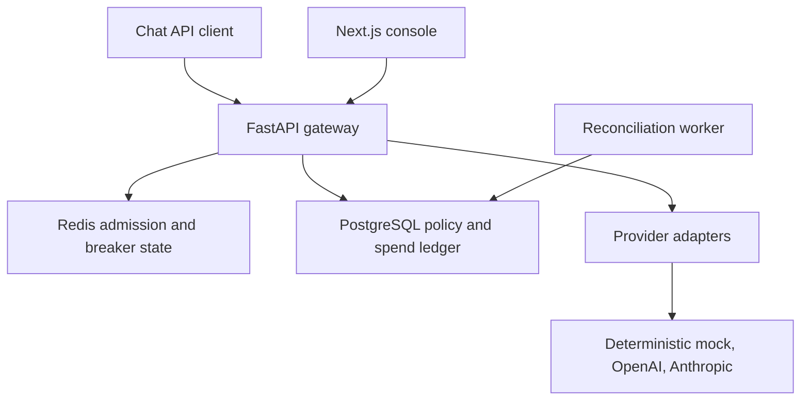

# Aegis AI Gateway

A multi-tenant gateway for text inference. Aegis provides a single Chat Completions API, selects an eligible deployment using a versioned routing policy, and records the financial exposure of every upstream attempt.

The engineering problem is coordinating requests across replicas without losing tenant isolation, duplicating a partially streamed response, or authorizing provider calls beyond an approved budget.

[Architecture](docs/architecture.md) · [API reference](docs/api.md) · [Local development](docs/local-development.md) · [Decisions](docs/adr/README.md) · [Verification](VERIFICATION.md)

## Architecture



Redis gates requests and coordinates recovery probes across gateway processes. PostgreSQL owns identity, policy, and the transaction that reserves spend before dispatch. The separate worker reconciles unresolved attempts. The console connects directly to the gateway for streaming and shows which views use sample data.

| Area | Implementation in this snapshot |
| --- | --- |
| Gateway | Python 3.12+, FastAPI, Pydantic, HTTPX, OpenAI-compatible text completions over JSON and SSE |
| Routing and resilience | Deterministic capability and cost filters, configurable scoring weights, opt-in weighted selection, atomic quotas, bounded fallback, and fenced half-open probes |
| Security and spend | Scoped HMAC-protected keys, RS256 OIDC policy administration, PostgreSQL row-level security, versioned prices, and per-attempt reservations |
| Console and telemetry | Next.js, TypeScript, Tailwind CSS and Recharts, with live model discovery, usage, playground, and policy edits. JSON logs, OpenTelemetry spans, and protected Prometheus metrics |
| Development | SQLAlchemy, Alembic, Redis Lua, Docker Compose, pytest, Vitest, Playwright, and GitHub Actions verification |

## Quick start

Use Docker with Compose v2, Python 3.12 or newer to generate local credentials, and `curl`. Run this first-time setup from the repository root. The command creates `.env` exclusively and will fail if it already exists.

```bash
python3 - <<'PY'
import json
import os
import secrets

os.umask(0o077)
names = (
    "POSTGRES_PASSWORD", "POSTGRES_APP_PASSWORD", "POSTGRES_WORKER_PASSWORD",
    "POSTGRES_ADMIN_PASSWORD", "REDIS_PASSWORD", "AEGIS_CURSOR_SECRET", "AEGIS_METRICS_TOKEN",
)
with open(".env", "x") as env:
    for name in names:
        env.write(f"{name}={secrets.token_hex(32)}\n")
    env.write("AEGIS_KEY_PEPPERS=" + json.dumps({"v1": secrets.token_hex(32)}) + "\n")
    env.write('AEGIS_ALLOWED_ORIGINS=["http://localhost:3000"]\n')
PY

docker compose up --build -d --wait backend worker
```

Compose starts PostgreSQL, Redis, and the Alembic migrator as dependencies. The gateway listens on `127.0.0.1:8000`. Provision a fresh demo tenant. If you repeat this step, use a new slug.

```bash
aegis_key="$(
  docker compose run --rm -T admin demo local-demo |
    python3 -c 'import json, sys; print(json.load(sys.stdin)["api_key"])'
)"
curl -fsS http://127.0.0.1:8000/v1/health
curl -fsS http://127.0.0.1:8000/v1/models -H "Authorization: Bearer $aegis_key"
curl -fsS http://127.0.0.1:8000/v1/chat/completions \
  -H "Authorization: Bearer $aegis_key" -H 'Content-Type: application/json' \
  -d '{"model":"mock-chat","messages":[{"role":"user","content":"Hello"}],"max_completion_tokens":5}'
```

The mock requires no provider account. For a short demo, [stream a completion and read its ledger usage](docs/api.md), then open the console with Node.js 22 or newer.

```bash
npm --prefix frontend ci
npm --prefix frontend run dev
```

Open [localhost:3000](http://localhost:3000), choose **Connect gateway**, and enter `http://127.0.0.1:8000` and the issued key. Run a request in **Playground**, then inspect **Cost intelligence**. Keep the key out of screenshots and shell traces.

## Tests and measured performance

```bash
docker compose --project-name aegis-backend-test --profile test run --build --rm tests
npm --prefix frontend run typecheck
npm --prefix frontend run lint
npm --prefix frontend test
npm --prefix frontend run build
```

Local verification recorded 52 passing backend tests on both CPython 3.12 and 3.13, 12 Vitest tests, and six Playwright tests. The browser and backend tests used disposable PostgreSQL and Redis running directly. The first GitHub Actions run built and started the containers and passed the backend and security jobs. [Verification report](VERIFICATION.md) · [CI workflow](.github/workflows/verify.yml) · [First hosted run](https://github.com/mrabishekraj2004-cpu/aegis-ai-gateway/actions/runs/43922504873)

| Two replicas, local mock | Responses | Requests/s | p50 | p95 | p99 | Errors |
| --- | ---: | ---: | ---: | ---: | ---: | ---: |
| 4 users | 1,618 | 82.23 | 48 ms | 81 ms | 120 ms | 0 |
| 16 users | 1,881 | 94.17 | 150 ms | 340 ms | 400 ms | 0 |

Each Locust profile ran for a nominal 20 seconds. At 16 users, mean scoring took approximately 53 µs, excluding Redis and PostgreSQL reads. [Environment, raw evidence, and reproduction](benchmarks/RESULTS.md)

## Deployment and limits

The local topology uses one gateway, one worker, a one-off migrator, PostgreSQL, and one Redis primary. The console is a static export. The documented production topology separates static hosting from an independently scaled gateway and worker, with TLS database connections, a private metrics path, and managed secrets. That topology is a design candidate. [Deployment architecture](docs/architecture.md#deployment-topology)

- The API supports text chat with one choice. Client retries are new requests. The gateway closes interrupted SSE after commitment without replaying a partial response.
- Hard-budget inference requires a certified billing bound. The mock is certified for its synthetic prices. OpenAI and Anthropic adapters have fixture coverage and require uncapped enrollment in this snapshot.
- Redis quotas and leases may regress on primary promotion. The tests verify shared decisions on one writable primary.
- The console labels unavailable management and operational views. Provider configuration and API-key lifecycle are available through the operator CLI.
