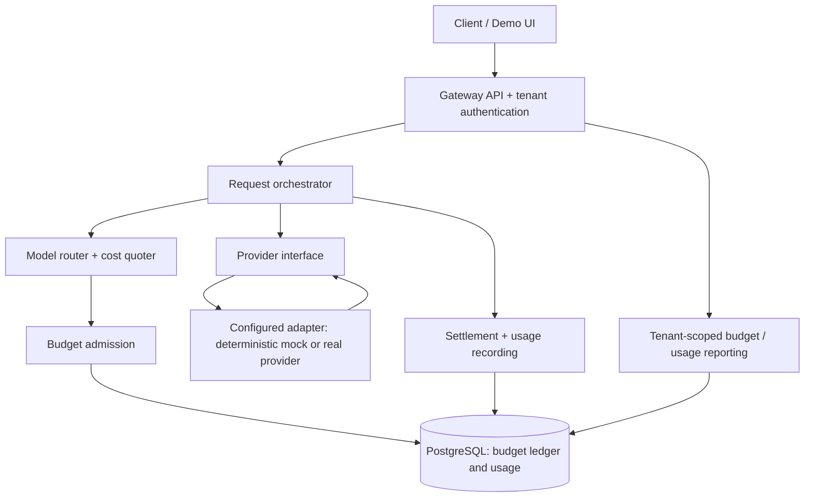

# Step 3 — Aegis AI Gateway System Architecture

**Prepared:** 2026-11-25  
**Inputs:** [`STEP1_PROJECT_PLAN.md`](./STEP1_PROJECT_PLAN.md), [`STEP2_REQUIREMENTS.md`](./STEP2_REQUIREMENTS.md)  
**Repository requested:** [mrabishekraj2004-cpu/aegis-ai-gateway](https://github.com/mrabishekraj2004-cpu/aegis-ai-gateway)

## 1. Repository status and design basis

The workspace contains the Step 1 and Step 2 planning documents but no Aegis Git checkout. Git reports that the workspace is not a repository. The connected GitHub repository reader returned HTTP 404 for the supplied URL and repository search found no matching repository. **No branch or commit is available to record; no source, tests, or CI were inspected.** The 404 does not prove whether the repository is private, renamed, or the URL is incorrect.

All design choices below are **proposed** and the implementation compatibility checks are called out explicitly. They are not claims about current functionality. Step 2 remains the requirements baseline, including trusted tenant identity, monthly UTC budget windows, integer micro-USD, exact-limit admission, pre-provider denial, tenant isolation, and deterministic mock behavior.

## 2. Proposed component boundaries

| Component | Responsibility | Compatibility check when source is available |
|---|---|---|
| Gateway API and authentication | Validate request shape; authenticate bearer credential; resolve tenant ID from server-side credential mapping; attach a trusted tenant context to downstream calls. | Existing route framework, auth middleware, identity provider, and any tenant header/body behavior. |
| Request orchestrator | Own request ID/idempotency flow and sequence routing, cost quote, admission, provider call, settlement, and response. | Existing handler/service boundaries and retry semantics. |
| Model router and cost quoter | Resolve public model alias to configured provider/model; apply configured token limit and price schedule; produce a conservative maximum charge quote before provider invocation. | Existing alias/config format, provider model names, pricing/usage assumptions. |
| Budget admission and ledger | Authoritatively admit or deny requests; atomically reserve funds by tenant/window; settle or release reservations; persist billable usage and attempt outcomes. | Existing database/storage, migrations, transaction support, and usage schema. |
| Provider adapter | Implement one provider contract; invoke selected route using a reservation-scoped idempotency key and cancellation signal; return output and actual usage. The local mock uses deterministic output, token counts, and cost. | Existing provider interface, SDK dependencies, timeout/cancellation behavior, mock support. |
| Usage/budget reporting | Read tenant-scoped budget window and usage entries from the authoritative store; return only rows for authenticated tenant. | Existing read endpoints, query patterns, and authorization filters. |

### Architecture overview



The gateway may implement these as modules in one service for the first release; the boundaries are logical responsibilities, not a proposal to deploy separate microservices.

## 3. Data model and authoritative spend

**Proposed authoritative store:** PostgreSQL is the source of truth for limits, active reservations, settled spend, and billable usage. Application memory and cache values are never authoritative for admission. This is a design choice, not a finding about existing dependencies; check for an existing transactional store before adopting it.

Amounts use signed integer micro-USD (`uUSD`), where 1 USD = 1,000,000 uUSD. Do not use floating point for limits or accounting. Store the pricing version/quote inputs used so a later audit can explain the estimate and settlement.

| Entity | Essential fields and constraints | Purpose |
|---|---|---|
| `tenants` | `tenant_id` primary key; display name; status; credential hash/reference; created timestamp | Credential-to-tenant mapping. Never store raw bearer secrets. Demo credentials are local-only secrets mapped to seeded tenant IDs. |
| `budget_windows` | `(tenant_id, window_start)` primary key; `window_end`; `limit_uusd`; `settled_uusd`; `reserved_uusd`; updated timestamp | One row per tenant per UTC calendar month. Admission locks this row. `settled_uusd + reserved_uusd` is the current committed exposure. |
| `request_attempts` | `request_id` primary key; `tenant_id`; idempotency key; request hash; alias; route; state; timestamps; sanitized error code | Audit/response state for admitted, denied, succeeded, failed, cancelled, or reconciliation-required attempts. Denials/failures are not billable usage. Unique `(tenant_id, idempotency_key)`. |
| `reservations` | `reservation_id` primary key; `request_id` unique; `tenant_id`; window start; quote `amount_uusd`; `state`; `expires_at`; `provider_started_at`; provider reference | Tracks reserved exposure and ensures a request is settled/released once. States: `active`, `settled`, `released`, `reconcile_required`. |
| `usage_entries` | `usage_id` primary key; `reservation_id` unique; `request_id`; `tenant_id`; window start; alias; provider/model; input/output tokens; `cost_uusd`; outcome; pricing version; created timestamp | Billable usage ledger. Unique reservation prevents duplicate usage/charges on settlement retries. Tenant/window index supports reporting. |

### Atomic admission and retry rules

1. Resolve authenticated tenant, route, configured maximum output, and a conservative quote before calling a provider.
2. In one database transaction, create/read the tenant's budget window and lock it (`SELECT ... FOR UPDATE`, or equivalent serializable conditional update). Check `settled_uusd + reserved_uusd + quote_uusd <= limit_uusd`.
3. Equality is admitted. If the sum is greater than the limit, write a denied attempt and commit without a reservation or provider invocation. Return the budget error.
4. If within limit, insert an active reservation and increment `reserved_uusd` by the quote in the same transaction. Commit before the external provider call; do not hold a database lock across network I/O.
5. Scope the idempotency key to the authenticated tenant and store a request-body hash. A retry with the same key and same hash returns the existing/in-progress operation; reusing a key with a different hash returns `409 idempotency_conflict`. Provider invocation uses the reservation/request ID as the provider idempotency key when the provider supports it.
6. Settlement is a transaction that locks the reservation and window. Only transition from `active` once; decrement reserved amount, insert the unique usage entry, increment settled spend by actual cost, update attempt state, and persist the result. A duplicate settlement returns the already-persisted result without charging again.

### Quote, settlement, failures, and recovery

- **Before invocation:** reserve a conservative maximum charge using the selected route's configured price and request limits. For the local mock, quote/cost is deterministic. A real provider route must bound output tokens and include applicable price components. If the gateway cannot establish a safe upper bound, it cannot promise hard pre-call enforcement for that route; Step 4 implementation planning must either exclude the route from this release or define a safe policy.
- **Success:** calculate actual cost from provider-reported usage and the pinned pricing version. Require `actual_uusd <= reserved_uusd`; release the unused difference and move actual cost to settled spend. Exact-limit requests are accepted and can settle at the limit.
- **Over budget:** do not create an active reservation and do not call the provider. Return `budget_exceeded`; persist only an attempt/denial record, not billable usage.
- **Provider failure before usage:** record a failed attempt and release the reservation. If partial usage is returned, record/settle that known usage and release the remainder.
- **Cancellation:** before dispatch, release immediately. After provider invocation, abort when supported and settle returned usage. The deterministic mock guarantees no charge when cancelled before returning usage. For real providers, if charge status is unknown, mark `reconcile_required` and retain the reservation rather than silently making budget available; do not automatically retry an ambiguous call.
- **Abandoned reservations:** store an expiry/lease and provider-start marker. A background reconciler may release expired reservations that are provably pre-dispatch. A reservation marked dispatching/provider-started with no result moves to `reconcile_required`; query provider status by idempotency/reference if supported, then settle or release. If no authoritative answer exists, keep the amount reserved and surface it for operator reconciliation. Never release an ambiguous post-dispatch reservation solely because a timeout elapsed.
- **Monthly rollover:** create a new `(tenant_id, window_start)` row for the next UTC month; preserve old windows and usage history. Use an injected/fixed clock in tests and the demo.

## 4. Proposed API and provider contracts

Existing endpoint compatibility cannot be checked. The following OpenAI-style shape is a proposal for the smallest request/response flow, not a claim that these routes exist.

### Request

`POST /v1/chat/completions`

Headers:

- `Authorization: Bearer <tenant-api-key>` — validated to a tenant server-side; caller-supplied tenant IDs do not override it.
- `Idempotency-Key: <opaque-client-key>` — required for budgeted requests and scoped to the authenticated tenant.

JSON body:

```json
{
  "model": "demo-model",
  "messages": [{"role": "user", "content": "Summarize this text."}],
  "max_tokens": 128
}
```

`model` is a public alias; `max_tokens` is required and bounded so the quoter can calculate a maximum charge. Streaming is out of scope for the first release. Reject unknown aliases and invalid limits before reservation.

### Success response

HTTP `200`; keep the external model field as the requested alias. In local demo mode, include the selected route for observability; a production response can omit backend internals and expose them in structured logs instead.

```json
{
  "id": "req_...",
  "model": "demo-model",
  "route": {"provider": "mock", "model": "mock-chat-v1"},
  "choices": [{"message": {"role": "assistant", "content": "..."}, "finish_reason": "stop"}],
  "usage": {"prompt_tokens": 12, "completion_tokens": 8, "total_tokens": 20, "cost_uusd": 2400},
  "budget": {"window_start": "2026-11-01T00:00:00Z", "limit_uusd": 1000000, "settled_uusd": 2400, "reserved_uusd": 0}
}
```

### Error response

Use a consistent envelope: `{"error":{"code":"...","message":"...","request_id":"...","retryable":false}}`. Do not return secrets, raw provider internals, or another tenant's budget data.

| Status | Code | Behavior |
|---|---|---|
| 400 | `invalid_request` | Malformed payload, invalid output limit, or unsupported body field. |
| 401 | `unauthorized` | Missing/invalid credential; do not disclose whether a tenant exists. |
| 404 | `model_not_found` | Alias is not configured for this gateway. |
| 409 | `idempotency_conflict` | Same tenant/key reused with a different request hash. |
| 429 | `budget_exceeded` | Proposed contract. Return request ID and this tenant's limit/remaining/quoted amount; provider call count remains unchanged. |
| 502 | `provider_error` | Provider failed. Return request ID and retryability; include usage/spend disposition only if known. |
| 503 | `admission_unavailable` | Ledger/database unavailable; fail closed before provider invocation. |

Client disconnect/cancellation has no guaranteed response to that client; record its final attempt/accounting state and follow the cancellation rules above. A usage/budget read endpoint should derive tenant from the same credential, for example `GET /v1/usage?from=...&to=...`, and must not accept an unchecked tenant selector.

### Provider interface

Proposed interface methods:

- `quote(route, request_limits) -> {max_cost_uusd, pricing_version}` — deterministic preflight upper bound.
- `invoke(route, request, {reservation_id, idempotency_key, cancellation_signal}) -> {response, input_tokens, output_tokens, actual_cost_uusd?, provider_request_id}`.
- Optional `lookup(idempotency_key) -> {status, usage/result}` for recovering ambiguous calls.

Adapters validate that actual cost does not exceed the reserved maximum. A deterministic `MockProvider` returns fixture output, configured token counts and exact cost, accepts a controllable failure/cancellation mode, records invocation IDs/counts, and makes no network requests. The demo/test selection is explicit (`AEGIS_PROVIDER=mock` or equivalent); it must not construct a paid SDK client or require paid credentials in mock mode. The environment variable name is illustrative until existing configuration is inspected.

## 5. Successful and denied request sequence

```mermaid
sequenceDiagram
    participant C as Client
    participant G as Gateway
    participant D as PostgreSQL ledger
    participant P as Provider adapter
    C->>G: POST request + bearer key + idempotency key
    G->>G: Authenticate tenant, route alias, calculate quote
    G->>D: Lock budget window; check and reserve atomically
    alt Quote exceeds remaining budget
        D-->>G: Denied; no reservation
        G-->>C: 429 budget_exceeded
        Note over G,P: Provider is not called
    else Budget admitted
        D-->>G: Reservation committed
        G->>P: Invoke with reservation id and cancellation signal
        P-->>G: Response and actual usage/cost
        G->>D: Settle once; write usage; release unused reservation
        D-->>G: Settled ledger state
        G-->>C: 200 response with request id and usage
    end
```

## 6. Local services, tests, and CI verification

Because source dependencies are unavailable, this section specifies required capabilities rather than claiming existing commands or services. **Proposed local stack:** gateway process plus PostgreSQL; deterministic mock runs in-process and no paid provider or external model service is needed. Use the repository's existing runtime and package manager if compatible. Do not add Redis for the first release; PostgreSQL transactions are the proposed single authority for atomic admission.

| Verification layer | Required checks |
|---|---|
| Unit tests | Alias resolves to configured mock route; quote uses integer arithmetic and configured limits; exact-limit `<=` behavior; actual cost and usage mapping; idempotency request hash behavior. |
| Database integration tests | Migrations and seed data; per-tenant/window row locking or conditional update; spend and reservation invariants; settlement idempotency and uniqueness of one usage entry per reservation; rollback on DB errors. |
| API/provider tests | Valid tenant credential routes request; invalid credential rejected; unknown alias rejected; mock mode runs with no paid keys; mock call counter proves budget denial happens before provider invocation; provider error/cancel state and reservation disposition. |
| Isolation tests | Tenant A cannot reserve against, query, or mutate tenant B's window/usage by spoofing a header/body/query parameter. |
| Concurrency test | Start two requests together with remaining budget for one quote; assert exactly one provider invocation succeeds, the other receives budget denial, and settled plus reserved never exceeds limit. Use PostgreSQL, not an in-memory substitute, for this assertion. |
| CI | Start a PostgreSQL service (or existing supported test database), apply migrations, run unit and integration tests, run formatting/lint/type checks available in the repository, and publish test results. No secrets required for mock-mode CI. |

Required coverage: R-01 through R-11 from Step 2, especially concurrency, no-provider-on-denial, exact limit, and failure/cancellation settlement. The precise local commands, database image/version, workflow names, and package additions are **unknown until the repository is accessible**.

### Repository compatibility checklist

On restored access, record branch and commit, then check: route framework and endpoint conventions; authentication middleware and tenant identity source; router/alias configuration; provider adapter signature and SDK initialization; database and migrations; transaction isolation/locking options; current usage schema and query authorization; cost/pricing model; retry/idempotency behavior; timeout/cancellation path; local service orchestration; dependency manifests; and current CI workflows/results. Map each proposed component to an existing module or identify the smallest extension. Revise any proposal that conflicts with verified source behavior before implementation.

## 7. Step 4 — UI/UX Design handoff

Design the demo as a short request journey with a visible tenant context and three distinct outcomes. Do not let the user switch tenant by editing an untrusted ID field.

1. **Demo request screen:** show the authenticated demo tenant, model alias selector, prompt field, bounded output limit, current budget window, settled spend, active reservations, and remaining amount. Make the deterministic mock/demo mode visible. Provide a send action and a usage/history view.
2. **Successful request state:** show response text, request ID, selected alias and demo route, returned token counts and cost in USD, and updated budget meter. Link the request to its usage row so the user can verify tracking.
3. **Budget denial state:** show a clear “budget exceeded” message, quoted amount versus remaining budget, and no generated response. Explain that the provider was not called and no billable usage was added. Keep the request ID for the denial attempt and offer a path to view the tenant's budget/usage.
4. **Provider failure state:** show a safe error summary and request ID, distinguish “no usage reported” from “usage recorded/charge pending reconciliation,” and reflect whether the reservation was released or remains reserved. Offer retry only when the result is known safe/idempotent; do not suggest blind retry for an ambiguous provider outcome.
5. **Tenant isolation:** if the demo presents a second tenant, make switching an explicit demo fixture/auth action, then show separate budgets and ledgers. Never present a caller-editable tenant ID as authority.

**Step 4 open design questions:** Should this journey be a simple API console or a dashboard plus request panel? Should route/provider internals be visible only in demo mode? How should a reconciliation-required reservation be explained? Which budget figures and history columns are needed to make the behavior clear without adding a full billing dashboard?

**Architecture status:** this is a proposed target design pending repository access. No component, dependency, test, or CI behavior is verified against Aegis source.
