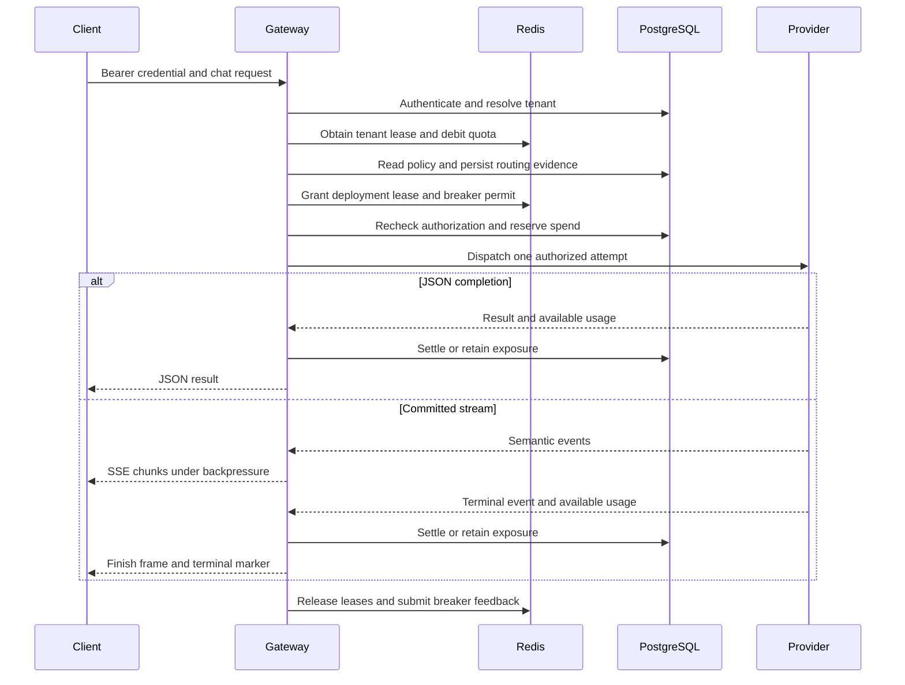
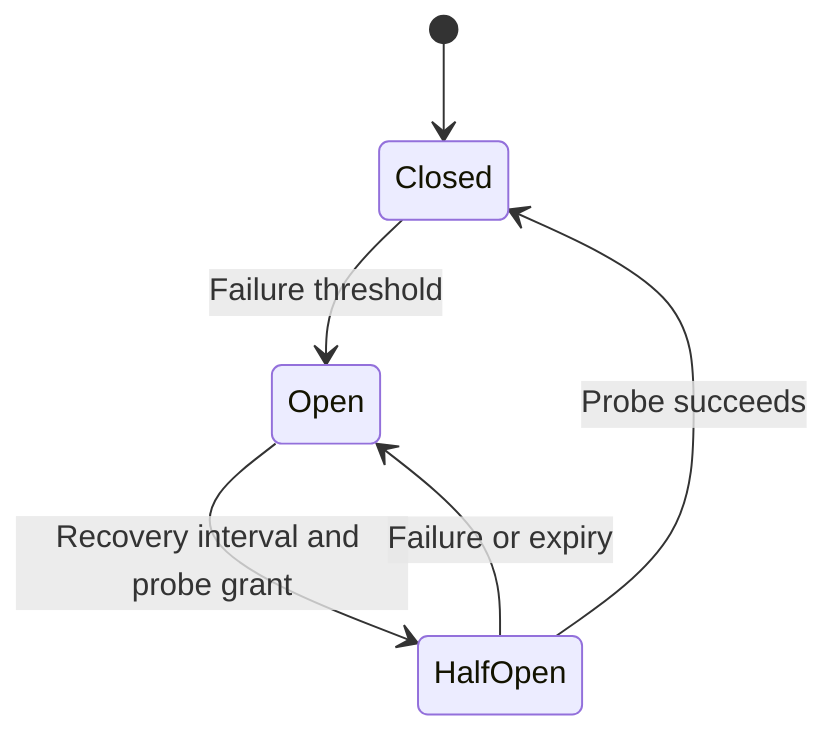
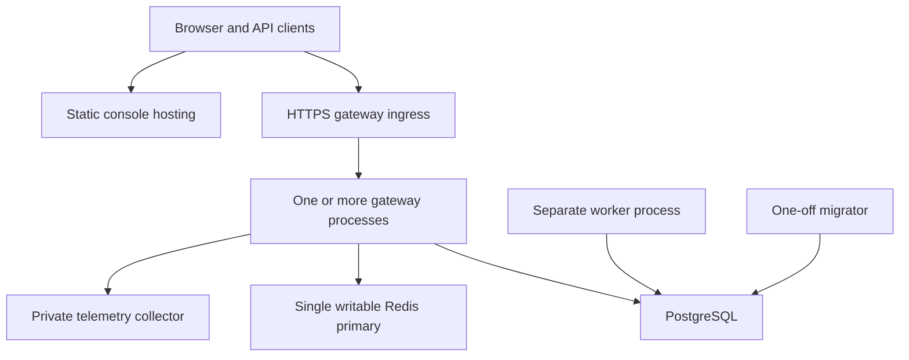

# Architecture

This document describes the implemented snapshot with Alembic revision `001_core`. The [blueprint](../BLUEPRINT.md) records proposed extensions and targets. The [verification report](../VERIFICATION.md) identifies the tested surface.

## Components and state ownership

| Component | Responsibilities |
| --- | --- |
| FastAPI gateway | Authenticate and authorize, parse a bounded request, apply Redis admission, resolve policy and catalog, invoke adapters, write JSON or SSE |
| PostgreSQL | Own identities, enrolled deployments, immutable policy and price revisions, inference attempts, budget periods, usage, ledger deltas, and audit events |
| Redis | Atomically debit token buckets, hold renewable capacity leases, coordinate fenced circuit probes and quota-group cooldowns, and retain operational observations |
| Provider adapters | Map the text contract into a fixed provider endpoint or the local mock, classify dispatch certainty, normalize usage and errors, and bound upstream decoding |
| Reconciliation worker | Recover unresolved accounts using a separate database role and the original period and rate card |
| Next.js console | Provide live model discovery, usage, routing policy administration and streaming. Label sample views and unavailable data explicitly |

## Inference lifecycle

The gateway authenticates before reading the body, then applies quota before model lookup. An authorized, syntactically valid request that targets an unknown alias therefore consumes quota. The flow above shows one attempt. Before commitment, an eligible failure may trigger a second authorization and reservation. Every retry or fallback receives a new attempt record while retaining the request identifier.

## Deterministic routing and provider adapters

The alias resolves to the tenant's active policy and enrolled deployments. Filtering considers region, model capabilities, context and output bounds, credential presence, inferred `auto` quality class, and certified spending bounds. An optional predicted-latency ceiling uses the selected class. The prediction comes from a Redis histogram or the deployment baseline. The scorer uses the following bounded integer penalties.

| Term | Penalty | Default weight |
| --- | --- | ---: |
| Cost | `min(10000, floor(10000 × estimate / cost_reference))` | 35 |
| Latency | `min(10000, floor(10000 × predicted_p95 / (2 × class_target)))` | 30 |
| Reliability | `min(10000, floor(10000 × bad_ppm / 100000))` | 25 |
| Priority | `10000 − 100 × configured_priority` | 10 |

A lower weighted sum ranks first. Ties resolve by higher priority, then deployment UUID bytes. Optional initial distribution draws a deterministic SHA-256 slot using server request ID, tenant, alias and policy revision. Eligible candidates need a positive weight and a score within the configured band. Live admission can skip a ranked candidate that is unavailable. PostgreSQL persists the algorithm, aggregate rejection reasons, weighted pick and up to three ranked candidates. Providers retain the public model alias in responses, while adapters use their enrolled upstream identifier.

The mock adapter returns repeatable text based on the message fingerprint and has deterministic failure variants for tests. The OpenAI and Anthropic adapters use HTTPX, fixed HTTPS hosts, bounded decoding and protocol-specific usage mapping. The gateway handles streaming commitment and accounting outside the adapter. [Routing implementation](../backend/aegis/routing.py) · [Provider interface](../backend/aegis/providers/base.py)

## Distributed admission and failure behavior

One Redis Lua script checks tenant and principal request and prompt-unit buckets against Redis time. It debits all four together upon approval. Concurrency leases limit concurrent tenant and deployment work, while each process has its own cap. Redis outage or lost admission lease stops dispatch. The scripts assume one writable primary. Primary promotion may regress ephemeral state. The durable spending gate remains in PostgreSQL.

A circuit is scoped to a deployment and credential revision. It opens after at least 10 classified attempts in 30 seconds at 50% or more failures. The first recovery interval is 10 seconds. Failed probes back off up to 60 seconds. A single owner and a generation fence prevent stale results from recovering the circuit. Provider overload or credential failures can cool a separate quota group. A missing breaker key starts with cold quarantine in managed configurations. Local Compose disables cold quarantine for its mock demo.

The gateway allows at most two provider attempts. Fallback targets must be explicitly connected in the policy's directed graph, satisfy all filters and pass live breaker and budget checks. A provably unsent connectivity failure can permit a same-deployment retry. Ambiguous failures need an explicit policy opt-in. A shared quota-group retry bucket and bounded jitter limit retry pressure.

JSON and SSE have separate total and upstream phase deadlines. The gateway delays SSE headers until semantic progress. After headers, failure terminates the stream with a redacted error event when the transport is writable and omits `[DONE]`. Cancellation closes the upstream stream and preserves uncertain exposure. [Stream lifecycle](api.md#streaming)

## Tenant security and accounting

API keys carry a public lookup ID and randomly generated secret. PostgreSQL stores an environment-bound HMAC digest and pepper version. A narrow lookup routine checks the key and grants access to its scopes. OIDC tokens use RS256, issuer, audience and time validation followed by current tenant membership checks. PostgreSQL forces RLS and sets tenant context within each transaction. Restricted database roles separate migrations, runtime, reconciliation and operator administration.

The spend ledger serializes authorization on the tenant's UTC month. A transaction checks the period cap and cumulative request exposure, then pins a price version and reserves the attempt hold. Confirmed unsent attempts can release the hold. Reported usage settles against the pinned rate. Ambiguous attempts remain pending until reconciliation or an audited adjustment. The worker conservatively estimates lingering attempts after the hold window, retaining distinctions between reported, estimated, adjusted and pending values. Integer microdollars and explicit token units make ledger calculations reproducible. External vendor invoices require additional evidence. [Accounting implementation](../backend/aegis/accounting.py) · [Credential and disclosure policy](../SECURITY.md)

## Observability

Gateway-assigned request IDs tie API responses to structured logs and OpenTelemetry spans. A separate bearer credential protects the per-process Prometheus registry. The routing histogram covers scorer evaluation after the catalog and Redis reads. Breaker metrics reflect the last state observed by the local process. The collector deployment is optional for local traces. Use the ledger for tenant monetary reports and scrape the runtime registry for operational aggregates. Keep the metrics listener private at the ingress.

## Deployment topology

Compose is the local topology. In a managed deployment, serve the static console over HTTPS and run the ASGI gateway and worker on infrastructure suitable for long-lived connections. Use separate database logins, verified TLS for PostgreSQL and Redis, an explicit console origin, a private collector path, and a managed store for peppers and upstream credentials. Configure the gateway against the expected schema and apply migrations before readiness. This repository contains verification CI and the local Compose definition. Managed failover, hosted smoke, container provenance and rollback rehearsals remain release work.
